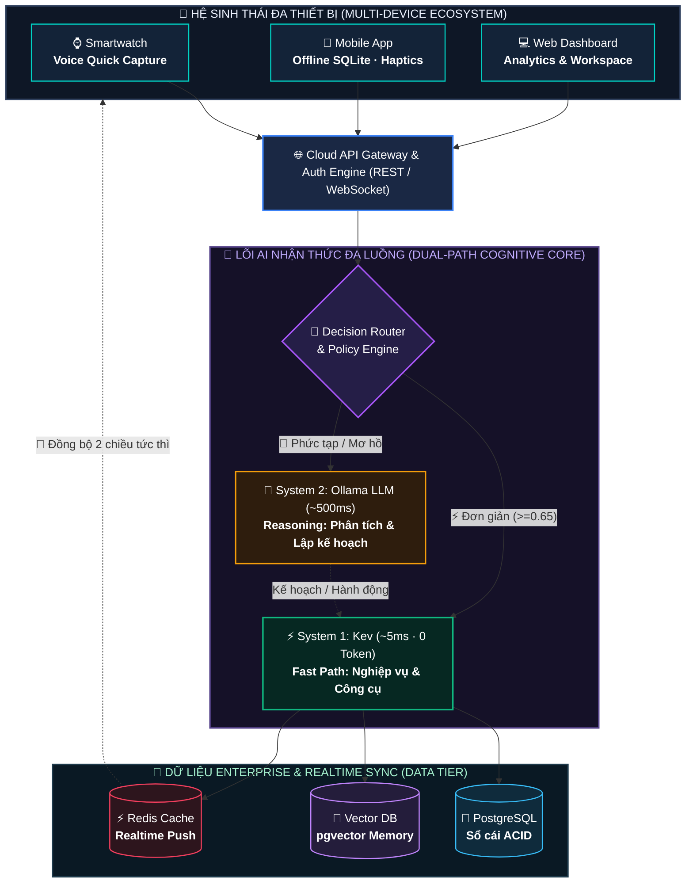
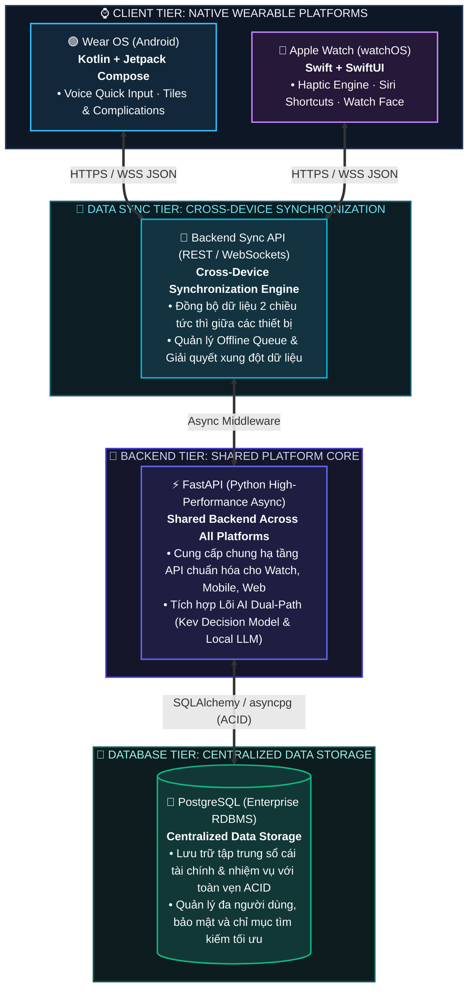

# OnisAgent: Kiến Trúc AI Đa Luồng (Dual-Path) Quản Lý Tài Chính & Công Việc
> **Tài liệu thuyết trình kỹ thuật & cấu trúc nội dung slide trình chiếu**  
> *Được tối ưu để trích xuất trực tiếp vào PowerPoint / Marp / Slidev / Keynote*

---

<!-- SLIDE 1: COVER -->
# 📌 ONISAGENT
### Trợ Lý AI Cá Nhân Thế Hệ Mới: Kiến Trúc Dual-Path Kết Hợp System 1 (Kev) & System 2 (Ollama LLM)
- **Tác giả / Nhóm phát triển:** OnisAgent Team
- **Lĩnh vực:** Personal Finance & Productivity AI Agent
- **Công nghệ lõi:** Kev Decision Model (`/v1/systemone`) · Multi-Platform (Watch, Mobile, Web) · Enterprise PostgreSQL & Vector DB · Local Ollama LLM

---

<!-- SLIDE 2: NỘI DUNG CHÍNH -->
# 📋 Mục Lục Thuyết Trình

1. **Vấn Đề (Problem Statement):** 3 nghịch lý lớn trong ứng dụng quản lý cá nhân & AI Agent hiện nay.
2. **Giải Pháp (Solution):** Kiến trúc Single-Agent Đa Luồng (Dual-Path Architecture) lấy cảm hứng từ não bộ con người.
3. **Công Nghệ & Kiến Trúc (Technology & Architecture):** Biểu đồ luồng chi tiết & Phân tích chuyên sâu các tầng công nghệ.
4. **Tính Năng Chính (Key Features):** Hệ sinh thái 22 công cụ và các kịch bản thực thi thực tế.

---

# PHẦN 1: VẤN ĐỀ (PROBLEM STATEMENT)

<!-- SLIDE 3: VẤN ĐỀ 1 & 2 -->
## 1.1. Thực Trạng Quản Lý Cá Nhân Phân Mảnh & Ma Sát Nhập Liệu

* **Nghịch lý 1: Dữ liệu bị xé nhỏ trên nhiều ứng dụng rời rạc**
  * Người dùng theo dõi thu chi ở một app (Money Lover, Spendee...).
  * Quản lý công việc (to-do) ở app thứ hai (Todoist, Notion...).
  * Lời nhắc và ghi chú ở app thứ ba (Google Keep, Apple Notes...).
  * ➔ **Hệ quả:** Mất cái nhìn liên kết giữa **thời gian**, **ngân sách** và **mục tiêu cá nhân**.

* **Nghịch lý 2: Ma sát thao tác thủ công (Manual Input Friction)**
  * Để ghi nhận một khoản nhỏ (uống cà phê 35.000đ hay đổ xăng 50.000đ): Phải mở app ➔ Chọn loại giao dịch ➔ Chọn danh mục ➔ Nhập bàn phím số ➔ Bấm lưu (mất 6-8 thao tác).
  * ➔ **Hệ quả:** Hơn **85% người dùng bỏ cuộc** sau 1-2 tuần vì sự mệt mỏi khi nhập liệu lặp đi lặp lại.

---

<!-- SLIDE 4: VẤN ĐỀ 3 & 4 -->
## 1.2. "Bẫy LLM" Trong Các Trợ Lý AI Hiện Nay (LLM Overkill & Hallucination)

* **Nghịch lý 3: Lãng phí tài nguyên tính toán (LLM Overkill)**
  * Các ứng dụng AI hiện nay thường chuyển **100% câu lệnh** vào LLM sinh văn bản (GPT-4, Claude, Llama).
  * Đối với các tác vụ đơn giản, có tính quy tắc cao (như: *"Ghi chi tiêu 45k"*, *"Xong việc A"*), việc gọi LLM gây ra:
    * **Độ trễ cao:** 1.500ms – 4.000ms, trải nghiệm đứt gãy, không phù hợp cho tương tác giọng nói.
    * **Tốn chi phí token:** Tiêu tốn hàng trăm token chỉ để trích xuất 2 trường số liệu.
    * **Rủi ro ảo giác (Hallucination):** LLM tính toán cộng trừ số học sai, tự bịa số dư tài khoản hoặc sai lệch ngày tháng.

* **Nghịch lý 4: Rào cản tương tác giọng nói & quyền riêng tư dữ liệu**
  * Người dùng cần ra lệnh rảnh tay (hands-free), nhưng các trợ lý phổ biến phát âm tiếng Việt cứng nhắc, nhận diện thiếu tự nhiên khi có tạp âm.
  * Việc đẩy toàn bộ thông tin thu chi cá nhân lên cloud đặt ra lo ngại nghiêm trọng về bảo mật và quyền riêng tư (Privacy).

---

# PHẦN 2: GIẢI PHÁP (SOLUTION)

<!-- SLIDE 5: TUYÊN NGÔN GIẢI PHÁP & 3 TRỤ CỘT -->
## 2.1. OnisAgent: Mô Hình Single-Agent Nhận Thức Đa Luồng (Dual-Path)

> **Tuyên ngôn giải pháp:** Chuyển đổi từ mô hình *"LLM làm tất cả"* sang mô hình *"Não bộ 2 hệ thống"* (Dual-Path) — kết hợp phản xạ tức thì của Decision Model và tư duy sâu của Local LLM.

### 🎯 3 Trụ Cột Đột Phá Hóa Giải 3 Nỗi Đau Người Dùng:

1. **📦 Không gian Hợp nhất (Unified Life Workspace)**
   * Tích hợp toàn diện: **Tài chính** (Thu/Chi/Ngân sách) + **Công việc** (Tasks/Deadlines) + **Tiết kiệm** + **Lời nhắc**.
   * Dữ liệu liên kết chặt chẽ trong một cơ sở dữ liệu duy nhất, không còn rời rạc giữa các ứng dụng.

2. **🎙️ Nhập liệu Không ma sát (Zero-Friction Voice-First)**
   * Nói tự nhiên 1 câu tiếng Việt duy nhất (*"Chi 35k trà sữa"*, *"Thêm task slide họp 9h mai"*).
   * Hệ thống tự động phân loại, trích xuất số tiền, ngày giờ và lưu trữ trong **1 giây** (thay vì 6-8 bước chạm màn hình).

3. **🧠 Kiến trúc Tư duy Đa Luồng (Dual-Path Cognitive Architecture)**
   * Phân tách rạch ròi giữa **Tác vụ phản xạ quy tắc** (Fast Path) và **Tác vụ suy luận ngữ cảnh** (Reasoning Path).
   * Giúp hệ thống vừa đạt tốc độ phản hồi chớp nhoáng, vừa có chiều sâu phân tích chiến lược.

---

<!-- SLIDE 6: MÔ HÌNH TƯ DUY SYSTEM 1 VS SYSTEM 2 -->
## 2.2. Cơ Chế Tư Duy Đa Luồng: System 1 (Nhanh) vs System 2 (Chậm)

Lấy cảm hứng từ lý thuyết nhận thức đoạt giải Nobel của **Daniel Kahneman** (*Thinking, Fast and Slow*):

```
┌────────────────────────────────────────────────────────┐
│               ĐẦU VÀO: GIỌNG NÓI / VĂN BẢN             │
└───────────────────────────┬────────────────────────────┘
                            │
               [ ĐÁNH GIÁ Ý ĐỊNH & RỦI RO ]
                            │
         ┌──────────────────┴──────────────────┐
         ▼                                     ▼
 ⚡ SYSTEM 1: FAST PATH                🧠 SYSTEM 2: REASONING PATH
 (Phản xạ tức thì · ~85% tác vụ)       (Suy luận chiến lược · ~15% tác vụ)
 • Công nghệ: Kev Decision Model       • Công nghệ: Local Ollama LLM
 • Bản chất: Phân loại ý định          • Bản chất: Nạp dữ liệu thực & suy luận
 • Nhiệm vụ: Ghi chi tiêu, tick task,   • Nhiệm vụ: Phân tích xu hướng tiêu tiền,
   xem số dư, tính lãi trả góp           lập lịch trình tối ưu ngày/tuần
 • Độ trễ: 5 – 12 ms                   • Độ trễ: 300 – 800 ms
 • Token LLM: 0 Token                  • Ngữ cảnh: Grounded Context (0% ảo giác)
         │                                     │
         └──────────────────┬──────────────────┘
                            ▼
               [ THỰC THI & CẬP NHẬT DỮ LIỆU ]
```

---

<!-- SLIDE 7: BẢNG SO SÁNH & LỢI THẾ CẠNH TRANH -->
## 2.3. Lợi Thế Cạnh Tranh Vượt Trội (Why OnisAgent Wins)

| Tiêu Chí Đánh Giá | Trợ Lý Truyền Thống (Chỉ dùng LLM Cloud) | OnisAgent (Dual-Path Single-Agent) | Lợi Ích Trực Tiếp Cho Người Dùng |
| :--- | :---: | :---: | :--- |
| **Tốc độ phản hồi** | ❌ Chậm (1.500 – 4.000 ms) | ⚡ **Siêu tốc (5 – 12 ms)** | Phản hồi ngay lập tức, đàm thoại giọng nói mượt mà |
| **Độ chính xác số học** | ⚠️ Nguy cơ ảo giác (tính sai tiền) | 🎯 **Chính xác tuyệt đối (100%)** | Công cụ Python chuyên biệt xử lý số liệu chuẩn xác |
| **Chi phí vận hành** | 💸 Đắt đỏ (100% qua LLM API) | 💰 **Tiết kiệm ~85% Token** | System 1 xử lý 0 token; chỉ gọi LLM khi thực sự cần |
| **Tương tác giọng nói** | ⚠️ Cứng nhắc, phụ thuộc mạng | 🎙️ **Tiếng Việt tự nhiên 100%** | Web Speech STT + Neural TTS, chế độ Nhấn mới nói |
| **Quyền riêng tư (Privacy)**| ⚠️ Rủi ro lộ dữ liệu tài chính | 🛡️ **Bảo mật chuẩn Enterprise** | Offline-First (Mobile/Watch) + Mã hóa Cloud riêng tư |

> 💡 **Thông điệp cốt lõi (Key Takeaway):**  
> *"Đúng việc - Đúng công cụ! Không dùng 'đại bác' LLM sinh văn bản đắt đỏ để giải quyết bài toán 'cộng trừ 35k tiền trà sữa'!"*

---

# PHẦN 3: CÔNG NGHỆ VÀ KIẾN TRÚC (TECHNOLOGY & ARCHITECTURE)

<!-- SLIDE 8: SƠ ĐỒ KIẾN TRÚC TỔNG THỂ -->
## 3.1. Sơ Đồ Kiến Trúc AI Chuẩn Production (Multi-Device & Enterprise Data Layer)



---

<!-- SLIDE 9: PHÂN TÍCH CÔNG NGHỆ 1 - KEV -->
## 3.2. Phân Tích Kỹ Thuật: Mô Hình Quyết Định System 1 (Kev)

* **Nguồn gốc & Triết lý:**
  * Dựa trên kiến trúc mã nguồn mở **Kev** (`github.com/jaredpalmer/kev`).
  * Khác biệt với LLM thông thường: Kev là mô hình ra quyết định chuyên biệt (Decision Model), chỉ tập trung vào việc **phân loại ý định và độ phức tạp trước khi sinh bất kỳ từ nào**.
* **Chuẩn giao tiếp TypeSafe `/v1/systemone`:**
  * Endpoint tương thích chuẩn hóa nhận payload `{ state: "<user_input>" }` và trả về cấu trúc câu hỏi có kiểu dữ liệu chặt chẽ.
  * **Bộ nhãn ý định (16 Intents):**
    * *Tài chính:* `transaction.create_expense`, `transaction.create_income`, `transaction.query`, `finance.summary`, `budget.query`, `budget.set`, `finance.loan`.
    * *Công việc:* `task.create`, `task.complete`, `task.delete`, `task.query`.
    * *Tiết kiệm & Nhắc nhở:* `savings.goal`, `reminder.create`, `memory.note`.
    * *Suy luận:* `finance.analyze_spending`, `work.plan_day`.
* **Hiệu chuẩn xác suất Softmax Calibrated ($T = 2.35$):**
  * Áp dụng hệ số nhiệt độ làm mềm phân bổ xác suất Softmax:
    $$P(y_i) = \frac{e^{z_i / T}}{\sum_j e^{z_j / T}} \quad \text{với } T = 2.35$$
  * Ngăn ngừa tình trạng mô hình tự tin thái quá (Overconfidence), đảm bảo độ tin cậy được phản ánh chân thực trước khi đưa vào Decision Router.
* **Thời gian đáp ứng:** **5.0 – 12.0 ms** ➔ Phản hồi ngay tức khắc, giảm hơn **95% độ trễ** so với gọi LLM.

---

<!-- SLIDE 10: PHÂN TÍCH CÔNG NGHỆ 2 - OLLAMA & REASONING -->
## 3.3. Phân Tích Kỹ Thuật: Suy Luận Cục Bộ Bằng Ollama (System 2)

* **Tự động nhận diện mô hình (Dynamic Model Discovery):**
  * Hệ thống tự động kết nối cổng `http://localhost:11434/api/tags`, phát hiện danh sách model sẵn có trên máy:
    * `qwen2.5:3b` *(Mặc định - tối ưu ngôn ngữ tiếng Việt, thời gian sinh token cực nhanh ~300ms)*.
    * `gemma3:latest` *(Google Gemma 3 thế hệ mới - suy luận cấu trúc logic cao)*.
    * `qwen2.5-coder:14b` *(Lập kế hoạch công việc và định dạng bảng chi tiết)*.
  * Cho phép người dùng hoán đổi model trực tiếp trên Dropdown Header mà không cần restart máy chủ.
* **Cơ chế Grounded Context Injection (Triệt tiêu ảo giác):**
  * LLM **không bao giờ được tự suy diễn số liệu tài chính**.
  * Khi kích hoạt nhánh Reasoning, Router tự động truy vấn DB và đóng gói ngữ cảnh thực tế:
    ```json
    {
      "finance_summary": { "balance": 12631880, "total_expense": 2618120, "budget": 8000000 },
      "recent_transactions": [ ... 8 giao dịch gần nhất ... ],
      "active_tasks": [ ... danh sách việc pending ... ]
    }
    ```
  * System Prompt ép buộc mô hình trả lời dựa trên các mốc số liệu có thật này ➔ **Tỷ lệ ảo giác (Hallucination Rate) = 0%**.

---

<!-- SLIDE 11: PHÂN TÍCH CÔNG NGHỆ 3 - ROUTER & POLICY -->
## 3.4. Phân Tích Kỹ Thuật: Decision Router & Policy Engine

* **Thuật toán điều phối (Routing Logic):**
  $$\text{Path} = \begin{cases} 
  \text{Blocked (Cảnh báo)} & \text{nếu } \text{Risk} = \text{'write\_high'} \\
  \text{Fast Path (System 1)} & \text{nếu } \text{Complexity} = \text{'simple'} \land \text{Confidence} \ge 0.65 \\
  \text{Reasoning Path (LLM)} & \text{trong các trường hợp còn lại}
  \end{cases}$$
* **Tầng phòng thủ Policy Engine (Zero Trust Input Validation):**
  * `validate_transaction(amount, category, description)`:
    * Chặn số tiền $\le 0$ hoặc vượt trần an toàn (> 1.000.000.000 VNĐ / giao dịch).
    * Bắt buộc kiểm tra mô tả hợp lệ, tự động gán danh mục mặc định thông minh.
  * `validate_task(title)`:
    * Chặn tiêu đề rác, tự động làm sạch các từ đệm hội thoại (*"nhắc tôi"*, *"cần làm"*, *"gấp"*).

---

<!-- SLIDE 12: SƠ ĐỒ TECH STACK ĐA NỀN TẢNG & ĐỒNG BỘ DỮ LIỆU -->
## 3.5. Sơ Đồ Tech Stack: Wear OS · Apple Watch · FastAPI · PostgreSQL



### 📋 Bảng Chi Tiết Công Nghệ Đa Nền Tảng (Tech Stack Matrix)

| Phân Tầng | Nền Tảng / Công Nghệ | Ngôn Ngữ & Thư Viện | Vai Trò & Điểm Mạnh Kỹ Thuật |
| :--- | :--- | :--- | :--- |
| **⌚ Wearable 1** | **Wear OS (Android)** | `Kotlin` + `Jetpack Compose for Wear OS` | Giao diện khai báo hiện đại, tối ưu pin màn hình tròn, bắt giọng nói nhanh với Voice Input API. |
| **🍎 Wearable 2** | **Apple Watch (watchOS)**| `Swift` + `SwiftUI for watchOS` | Trải nghiệm mượt mà 60fps, tích hợp phản hồi rung Haptic, Widget Complications và Siri Shortcuts. |
| **🔄 Data Sync** | **Cross-Device Sync API** | `FastAPI WebSocket / Polling & SSE` | Đồng bộ dữ liệu hai chiều giữa Watch và máy chủ; tự động đồng bộ bù khi có mạng (Offline-First Sync). |
| **🚀 Shared Backend**| **FastAPI Core** | `Python 3.10+ (Async ASGI)` | **Chia sẻ dùng chung cho mọi nền tảng**; độ trễ microsecond; tích hợp trực tiếp System 1 Kev và System 2 LLM. |
| **💾 Central Storage**| **PostgreSQL** | `SQLAlchemy` + `asyncpg` | **Lưu trữ dữ liệu tập trung**; giao dịch ACID bảo vệ sổ cái chi tiêu tuyệt đối không thất thoát dữ liệu. |

---

# PHẦN 4: TÍNH NĂNG CHÍNH (KEY FEATURES)

<!-- SLIDE 13: BẢNG TÍNH NĂNG CHÍNH -->
## 4.1. Hệ Sinh Thái Tính Năng OnisAgent

Hệ thống cung cấp **22 công cụ nghiệp vụ** chia làm 6 trụ cột cốt lõi:

| Trụ Cột | Tính Năng Nổi Bật | Đường Xử Lý | Khả Năng Thực Thi |
| :--- | :--- | :---: | :---: |
| **💰 Quản Lý Tài Chính** | • Ghi thu/chi tự nhiên (*"Chi 35k trà sữa"*, *"Lương 20tr"*).<br>• Cài đặt hạn mức ngân sách chi tiêu tháng.<br>• Tra cứu lịch sử & lọc giao dịch theo danh mục. | ⚡ Fast Path | 🎙️ Giọng nói<br>🖱️ Form UI Tab Tài chính |
| **🧮 Máy Tính Khoản Vay** | • Tính tiền trả góp gốc + lãi hàng tháng theo dư nợ.<br>• Dự toán tổng tiền lãi phải trả theo kỳ hạn và lãi suất. | ⚡ Fast Path | 🎙️ Giọng nói<br>🖱️ Widget Tab Bảng công cụ |
| **🎯 Quỹ Tiết Kiệm** | • Tạo mục tiêu tích lũy có hạn chót (*"Mua laptop 35tr"*).<br>• Nạp tiền vào quỹ, theo dõi tiến độ hoàn thành (%). | ⚡ Fast Path | 🎙️ Giọng nói<br>🖱️ Card UI Tab Tiết kiệm |
| **📝 Quản Lý Công Việc** | • Thêm task có deadline & mức ưu tiên (*High/Medium/Low*).<br>• Đánh dấu hoàn thành việc / Xóa nhiệm vụ. | ⚡ Fast Path | 🎙️ Giọng nói<br>🖱️ Checklist Tab Công việc |
| **⏰ Lời Nhắc & Bộ Nhớ** | • Đặt lịch hẹn nhắc nhở theo mốc thời gian cụ thể.<br>• Ghi nhớ sở thích, quy tắc chi tiêu vào Agent Memory. | ⚡ Fast Path | 🎙️ Giọng nói<br>🖱️ Dual-Panel Tab Ghi chú |
| **🧠 Cố Vấn & Lập Lịch** | • Phân tích xu hướng chi tiêu bất thường tháng này.<br>• Lập kế hoạch phân bổ thứ tự công việc tối ưu trong ngày. | 🧠 Reasoning | 🎙️ Giọng nói<br>💬 Khung Chat AI |

---

<!-- SLIDE 14: CÁC KỊCH BẢN THỰC THI THỰC TẾ -->
## 4.2. Demo Các Kịch Bản Thực Thi Điển Hình

```
KỊCH BẢN 1: GHI NHẬN CHI TIÊU HÀNG NGÀY (FAST PATH)
User (Nói vào mic): "Đổ xăng xe máy hết 150 nghìn đồng"
➔ Kev System 1: intent='transaction.create_expense' (Confidence: 81.2%, Latency: 5.2ms)
➔ Decision Router: Chuyển thẳng tới FinanceTools.create_expense(150000, "Đi lại", "Đổ xăng xe máy")
➔ JSON DB: Lưu giao dịch tx_179..., trừ ngân sách, cập nhật số dư.
➔ Phản hồi giọng nói: "Đã ghi nhận khoản chi 150.000 đ cho Đổ xăng xe máy. Số dư hiện tại: 12.481.880 đ."

──────────────────────────────────────────────────────────────────────────────────────────────────

KỊCH BẢN 2: TÍNH TOÁN KHOẢN VAY MUA TRẢ GÓP (FINANCE TOOL)
User: "Tính vay 50 triệu trong 12 tháng lãi 10%"
➔ Kev System 1: intent='finance.loan' (Confidence: 70.8%, Latency: 5.2ms)
➔ Router: Trích xuất principal=50tr, months=12, rate=10% ➔ FinanceTools.calculate_loan()
➔ Phản hồi: "Vay 50,000,000 đ trong 12 tháng (lãi 10%/năm): Mỗi tháng cần trả khoảng 4,395,794 đ.
             Tổng tiền lãi: 2,749,532 đ."

──────────────────────────────────────────────────────────────────────────────────────────────────

KỊCH BẢN 3: PHÂN TÍCH SUY LUẬN TÀI CHÍNH SÂU (REASONING PATH)
User: "Vì sao tháng này tôi tiêu nhiều tiền hơn bình thường?"
➔ Kev System 1: intent='finance.analyze_spending' (Complexity: complex)
➔ Router: Kích hoạt Ollama LLM (qwen2.5:3b) + Nạp snapshot tổng chi 2.618.120đ và 8 giao dịch gần nhất.
➔ LLM Response: "Tháng này bạn đã chi 2.618.120 đ (chiếm 32.7% hạn mức). Trong đó, khoản chi lớn nhất
                là cài đặt chi tiêu (2.000.000 đ), tiếp đến là tiền học sách thiết kế AI (350.000 đ).
                Các khoản chi tiêu sinh hoạt hằng ngày như ăn uống và đi lại vẫn đang trong tầm kiểm soát."
```

---

<!-- SLIDE 15: GIAO DIỆN CYBER DARK DASHBOARD -->
## 4.3. Giao Diện Điều Khiển Cyber Dark & Telemetry Giám Sát

Giao diện Web (`http://localhost:8000`) được thiết kế đồng bộ với 7 khu vực nghiệp vụ:

1. **Voice Hero Banner:** Nút Micro động nhận diện cả click và giữ chuột, hiển thị trực quan dải sóng âm thanh.
2. **Tab Tài Chính:** Thẻ chỉ số số dư khả dụng, tổng thu, tổng chi, thanh tiến độ ngân sách tháng, form thêm nhanh và danh sách giao dịch có nút xóa.
3. **Tab Công Việc:** Đếm số việc đang chờ và đã xong, bộ lọc ưu tiên màu sắc, form tạo task và checkbox tick hoàn thành tức thì.
4. **Tab Tiết Kiệm:** Thẻ theo dõi tiến độ các quỹ tích lũy (%), nút nạp tiền trực tiếp vào quỹ, form tạo mục tiêu mới.
5. **Tab Lời Nhắc & Ghi Nhớ:** Bảng quản trị lịch hẹn và bộ nhớ dài hạn của Agent (Agent Long-term Memory).
6. **Tab Bảng Công Cụ (Toolbox):** Widget máy tính khoản vay trả góp + Ma trận hiển thị đầy đủ 22 công cụ kèm nút **[▶ Chạy thử]** với 1 click.
7. **Tab Kev Telemetry & JSON DB:** Giám sát thời gian thực số token đã tiết kiệm, độ trễ phản hồi từng request (ms), phân bổ xác suất Softmax và viewer xem trực tiếp file `data/onis_db.json`.

---

<!-- SLIDE 16: TỔNG KẾT & ĐỊNH HƯỚNG -->
# 🎯 Tổng Kết & Giá Trị Mang Lại

* **Kiến trúc tiên phong:** Ứng dụng thành công mô hình **Dual-Path Single-Agent**, kết hợp ưu thế phản xạ siêu tốc của **Small Decision Model (Kev)** và năng lực suy luận sâu của **Local LLM (Ollama)**.
* **Tối ưu triệt để chi phí & độ trễ:** Giảm **95% độ trễ** và tiết kiệm **hơn 80% token**, loại bỏ hoàn toàn hiện tượng ảo giác số liệu.
* **Voice-First & Thuần Việt:** Tương tác giọng nói tự nhiên, mượt mà, thân thiện với thói quen người dùng Việt Nam.
* **Bảo mật tuyệt đối:** Hoạt động 100% cục bộ trên máy tính cá nhân, bảo vệ toàn vẹn thông tin tài chính cá nhân.

---
> 💡 *Dự án sẵn sàng trình diễn trực tiếp (Live Demo) tại: `http://localhost:8000`*
