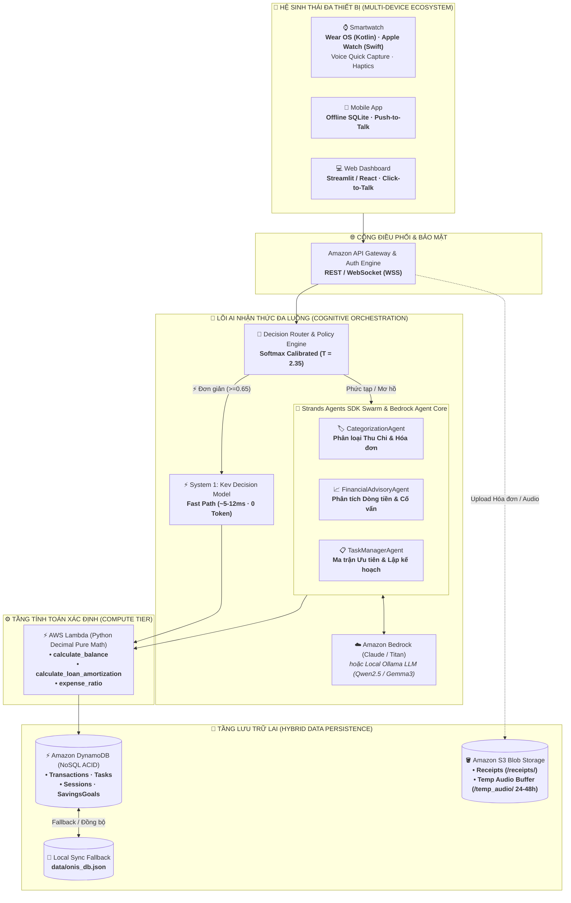

# OnisAgent – Trợ Lý AI Cá Nhân Quản Lý Tài Chính & Công Việc
> **AI Agent for Personal Task and Financial Management**  
> Dự án tham dự Cuộc thi **Da Nang AI4Life** – Trường Đại học Công nghệ Thông tin và Truyền thông Việt - Hàn (VKU), Đại học Đà Nẵng.

[](https://www.python.org/)
[](https://opensource.org/licenses/MIT)
[](#-kiến-trúc-hệ-thống-dual-path-cognitive-architecture)
[](#-kiến-trúc-hệ-thống-dual-path-cognitive-architecture)
[](#-bộ-3-tính-năng-tài-chính-cốt-lõi--quản-lý-công-việc)

---

## 👥 Nhóm Tác Giả & Phân Công Trách Nhiệm

* **Trịnh Quyết Chiến** – MSSV: `23IT.B019` – Lớp: `23JIT` – Email: `chientq.23itb@vku.udn.vn`  
  *Phụ trách:* Lõi AI Agent, Amazon Bedrock, Strands Agents SDK Swarm, AWS Lambda và mô hình điều phối Dual-Path.
* **Hứa Huỳnh Anh** – MSSV: `23IT.B002` – Lớp: `23JIT` – Email: `anhhh.23itb@vku.udn.vn`  
  *Phụ trách:* Cơ sở dữ liệu DynamoDB & S3 Hybrid Storage, Giao diện Web/Streamlit, Speech Pipeline (STT/TTS) và chốt kiểm soát Human-in-the-Loop.

---

## 🎯 Giới Thiệu Tổng Quan & Vấn Đề Cần Giải Quyết

Trong quản lý cuộc sống hằng ngày, người dùng cá nhân phải đối mặt với **3 rào cản lớn**:
1. **Dữ liệu bị phân mảnh:** Thu chi được theo dõi ở một ứng dụng (Money Lover, Spendee), công việc/deadline ở ứng dụng khác (Todoist, Notion), ghi chú ở ứng dụng thứ ba (Google Keep, Apple Notes), làm mất liên kết tổng thể giữa thời gian, ngân sách và mục tiêu cuộc sống.
2. **Ma sát nhập liệu thủ công (Manual Input Friction):** Việc phải thực hiện từ 6–8 thao tác chạm chỉ để ghi một khoản phở 45k hay tiền điện khiến hơn **85% người dùng bỏ cuộc sau 1–2 tuần**.
3. **Bẫy ảo giác số liệu của AI Chatbot (LLM Hallucination):** Các ứng dụng chatbot LLM thông thường chuyển 100% câu thoại vào LLM để sinh văn bản, dẫn đến độ trễ cao (1,5–4 giây), tốn chi phí token và có nguy cơ tính toán sai số dư tài chính.

### 💡 Giải Pháp OnisAgent:
- **Hợp nhất không gian sống (Unified Life Workspace):** Tích hợp tài chính, công việc, tiết kiệm và lời nhắc trong một hệ thống dữ liệu duy nhất.
- **Kiến trúc Single-Agent Đa Luồng (Dual-Path Cognitive Architecture):** Tách bạch phản xạ tức thì (System 1) và tư duy chiến lược (System 2).
- **Triết lý chống ảo giác số học:** *"Models reason, software computes"* – LLM đảm nhiệm suy luận ngữ cảnh; mã nguồn Python sử dụng `Decimal` thuần túy trên AWS Lambda chịu trách nhiệm tính toán với độ chính xác tuyệt đối **100%**.
- **Tương tác Voice-First hai chiều:** Hỗ trợ giọng nói tiếng Việt tự nhiên qua Speech-to-Text (STT) và Neural Text-to-Speech (TTS) với 2 chế độ *Click-to-Talk* & *Push-to-Talk*, tổng độ trễ $\le 2$ giây.
- **Chốt kiểm soát Human-in-the-Loop (HITL Approval Gate):** Bắt buộc người dùng bấm xác nhận trực tiếp trước các quyết định quan trọng.

---

## 🧠 Kiến Trúc Hệ Thống (Dual-Path Cognitive Architecture)

OnisAgent vận hành trên mô hình nhận thức hai luồng lấy cảm hứng từ lý thuyết nhận thức của Daniel Kahneman:

```
┌────────────────────────────────────────────────────────────────────────┐
│               ĐẦU VÀO: GIỌNG NÓI TIẾNG VIỆT / VĂN BẢN                  │
│       (Click-to-Talk / Push-to-Talk · STT Web Speech / Whisper)        │
└───────────────────────────────────┬────────────────────────────────────┘
                                    │
                  [ 🧭 DECISION ROUTER & POLICY ENGINE ]
                                    │
            ┌───────────────────────┴───────────────────────┐
            ▼                                               ▼
  ⚡ SYSTEM 1: FAST PATH                        🧠 SYSTEM 2: REASONING PATH
  (Phản xạ tức thì · ~85% tác vụ)               (Suy luận sâu · ~15% tác vụ)
  • Mô hình: Kev Decision Model                 • Mô hình: Amazon Bedrock / Ollama LLM
  • Độ trễ: ~5 – 12 ms                          • Độ trễ: ~300 – 800 ms
  • Chi phí: 0 Token LLM                        • Ngữ cảnh: Grounded Context (0% ảo giác)
  • Tác vụ: Ghi nhận thu chi, tạo task,         • Tác vụ: Phân tích xu hướng dòng tiền sâu,
    xem số dư                                  dự toán khoản vay, lập kế hoạch ngày/tuần
            │                                               │
            │                                 [ 🐝 STRANDS MULTI-AGENT SWARM ]
            │                                 ├── CategorizationAgent
            │                                 ├── FinancialAdvisoryAgent
            │                                 └── TaskManagerAgent
            │                                               │
            └───────────────────────┬───────────────────────┘
                                    ▼
       [ 🚀 COMPUTE TIER: DETERMINISTIC PYTHON DECIMAL ON AWS LAMBDA ]
       (calculate_balance, calculate_loan_amortization, expense_ratio)
                                    │
                                    ▼
       [ 💾 DATA TIER: DYNAMODB & S3 HYBRID STORAGE / LOCAL FALLBACK ]
       (Transactions, Tasks, Sessions, SavingsGoals | S3 Receipts & Temp Audio)
```

### 🧭 Cơ Chế Decision Router
- **Fast Path (System 1 / Kev Decision Model):** Xử lý phản xạ tức thì (**~5–12 ms**, **0 Token LLM**) cho khoảng 85% tác vụ lặp lại (thêm thu chi, tạo task, xem số dư). Kích hoạt khi độ phức tạp là `simple` và điểm tin cậy Softmax Calibrated ($T=2.35$) đạt $\ge 0.65$.
- **Reasoning Path (System 2 / Amazon Bedrock / Ollama LLM):** Phân tích dòng tiền sâu, dự toán khoản vay và lập kế hoạch ngày/tuần. Áp dụng kỹ thuật **Grounded Context Injection** – mọi số liệu tài chính phải do Python `Decimal` tính trước (bao gồm calculator chạy trên AWS Lambda) rồi mới được dùng để diễn giải.
- **Multi-Agent Swarm (Strands Agents SDK):** Phân chia 3 Sub-Agents chuyên trách:
  1. `CategorizationAgent`: Tự động trích xuất và phân loại thu/chi từ câu thoại tiếng Việt, văn bản hoặc nội dung OCR của ảnh hóa đơn.
  2. `FinancialAdvisoryAgent`: Phân tích xu hướng dòng tiền, dự toán khoản vay, hỗ trợ lập mục tiêu tiết kiệm có thời hạn và cảnh báo biến động bất thường.
  3. `TaskManagerAgent`: Quản lý công việc, xây dựng Ma trận Ưu tiên Động và lập kế hoạch ngày/tuần.

---

## 🏛️ Sơ Đồ Kiến Trúc Hạ Tầng AWS (AWS Cloud Infrastructure)



---

## 💎 Bộ 3 Tính Năng Tài Chính Cốt Lõi & Quản Lý Công Việc

### 1. 💰 Ghi Nhận & Phân Loại Thu Chi Tự Động (Automated Cash Flow)
- Tự động trích xuất mô tả, số tiền và danh mục từ câu thoại tiếng Việt, văn bản người dùng nhập hoặc nội dung OCR từ ảnh hóa đơn/biên lai.
- Không tự suy đoán trường dữ liệu chưa rõ; yêu cầu người dùng bổ sung khi cần.
- Truy vấn số dư sổ cái và phân tích xu hướng dòng tiền trực quan.

### 2. 🧮 Máy Tính Khoản Vay Dư Nợ Giảm Dần (Loan Amortization Calculator)
- Minh chứng tuyệt đối cho triết lý *"Models reason, software computes"*: Sử dụng mã nguồn Python `Decimal` thuần túy thực thi trên **AWS Lambda**, bảo đảm độ chính xác số học **100%**, loại bỏ hoàn toàn sai số dấu phẩy động (`float`) và nguy cơ ảo giác từ LLM.
- Tự động lập lịch trả góp gốc + lãi hàng tháng, tính tổng lãi phải trả theo thời hạn vay và lãi suất thực tế:
  $$\text{Niên kim hàng tháng } (PMT) = P \times \frac{r(1+r)^n}{(1+r)^n - 1}$$
- *Ví dụ mẫu:* Vay 50.000.000 đ trong 12 tháng lãi suất 10%/năm $\rightarrow$ 11 kỳ đầu trả 4.395.794 đ, kỳ cuối được điều chỉnh theo số dư còn lại thành 4.395.799 đ; tổng thanh toán 52.749.533 đ, tổng lãi 2.749.533 đ.

### 3. 🎯 Quỹ Tiết Kiệm & Lời Nhắc Thông Minh (Savings Goals & Smart Reminders)
- Khởi tạo mục tiêu tích lũy có số tiền và thời hạn (Ví dụ: *"Mua laptop 35 triệu trước tháng 12"*).
- Theo dõi tiến độ, đề xuất lời nhắc theo hạn mục tiêu và chủ động cảnh báo khi phát hiện biến động thu chi bất thường; người dùng quyết định hành động tiếp theo.

### 4. 📝 Quản Lý Công Việc & Ma Trận Ưu Tiên Động (Tasks & Dynamic Priority Matrix)
- Khởi tạo, cập nhật tiến độ, tick hoàn thành công việc từ câu thoại giọng nói tiếng Việt.
- Tự động sắp xếp công việc theo Ma trận Ưu tiên Động (Eisenhower linh hoạt) dựa trên thời hạn chót (Deadline) và ngân sách thời gian thực tế.

---

## 🛡️ Chốt Kiểm Soát Human-in-the-Loop (3 Trigger Gates)

Theo nguyên tắc **"AI đề xuất, Người dùng quyết định" (AI Proposes, Human Disposes)**, OnisAgent bắt buộc người dùng bấm xác nhận trực tiếp trước các thao tác:
1. **Gate 1 - Xác Nhận Lịch Trả Góp / Quỹ Tiết Kiệm Mới:** Bắt buộc bấm xác nhận trước khi áp dụng lịch trả góp khoản vay hoặc ghi nhận mục tiêu tiết kiệm vào CSDL. Cảnh báo bất thường chỉ là thông tin để người dùng xem xét, không tự tạo giao dịch hay thay đổi dữ liệu.
2. **Gate 2 - Đính Chính Phân Loại (Re-classification):** Lưu vết `Correction History` cô lập theo `user_id` mỗi khi người dùng sửa đổi danh mục do AI đề xuất, làm dữ liệu ngữ cảnh tinh chỉnh cá nhân hóa trong tương lai.
3. **Gate 3 - Thao Tác Rủi Ro Cao (`write_high`):** Chặn đứng tự động và kích hoạt cảnh báo 2 lớp khi phát hiện thao tác sửa đổi số dư ban đầu hoặc xóa công việc hàng loạt.

---

## 🎙️ Tương Tác Giọng Nói Hai Chiều Voice-First (Speech Pipeline)

- **2 chế độ tương tác linh hoạt:**
  - **Click-to-Talk:** Chạm để kích hoạt thu âm trên Web/Mobile, tự động kết thúc khi dứt câu.
  - **Push-to-Talk:** Nhấn giữ để nói (phù hợp cho thao tác 1 tay trên điện thoại hoặc núm xoay Smartwatch), tích hợp phản hồi rung Haptic.
- **Chuẩn hóa ngôn ngữ & tiếng lóng tiếng Việt:** Nhận diện mượt mà *"45k"*, *"20 củ"*, *"nửa triệu"*, *"lít"*, v.v.
- **Ngân sách độ trễ âm thanh toàn trình $\le 2$ giây:** Từ lúc người dùng dứt lời đến khi Neural TTS phát câu phản hồi súc tích ($\le 2$ câu).

---

## 📊 Bảng So Sánh Lợi Thế Vượt Trội

| Tiêu Chí Đánh Giá | Trợ Lý Truyền Thống (LLM-Only Cloud) | OnisAgent (Dual-Path Cognitive Architecture) |
|---|:---:|:---:|
| **Thời gian phản hồi** | Chậm (1.500 – 4.000 ms) | ⚡ **Siêu tốc: ~5–12 ms (Fast Path cho ~85% tác vụ)** |
| **Độ chính xác tính toán** | Nguy cơ ảo giác số liệu, cộng trừ sai | 🎯 **Chính xác tuyệt đối 100% (Pure Python Decimal)** |
| **Chi phí Token LLM** | Tiêu tốn Token cho mọi câu lệnh | 💰 **Tiết kiệm 80–90% Token (Fast Path dùng 0 Token)** |
| **Tương tác giọng nói** | Cứng nhắc, độ trễ đàm thoại cao | 🎙️ **Voice-First Tiếng Việt hai chiều ($\le 2$ giây)** |
| **Quyền riêng tư dữ liệu** | Gửi toàn bộ dữ liệu lên Cloud bên thứ ba | 🛡️ **Bảo mật Enterprise (Tenant Isolation, Temp Audio tự hủy 24-48h)** |

---

## 📁 Cấu Trúc Thư Mục Dự Án

```text
OnisAgent/
├── data/
│   ├── raw/kev_dataset_raw.jsonl
│   ├── clean/kev_dataset_clean.jsonl
│   └── splits/kev_{train,val,test}.jsonl
├── models/checkpoints/.gitkeep                 # Model weights/checkpoints are gitignored
├── scripts/
│   ├── data_prep/                              # Cleaning and deterministic splitting
│   └── training/                               # Training and evaluation entry points
├── src/
│   ├── models/kev/                             # Dataset formatter and inference adapter
│   ├── agents/                                 # Multi-Agent Swarm (Strands SDK)
│   ├── tools/                                  # Deterministic calculations and Lambda handlers
│   ├── database/                               # DynamoDB and local storage
│   └── utils/                                  # Parsing and logging
├── docs/adr/                                   # Architecture Decision Records
├── app/                                        # Streamlit UI
└── tests/                                      # Unit tests
```

Kev scripts live under `scripts/data_prep/`; generated splits are written to `data/splits/`. The `train_kev.py` and `eval_kev.py` entry points use explicit framework/model adapters because this repository does not currently select or depend on a fine-tuning framework or model backbone.

Dataset preparation and formatting commands:

```powershell
python -m scripts.data_prep.clean_dataset
python -m scripts.data_prep.split_dataset
python -m src.models.kev.dataset_formatter --format unsloth --output data/splits/kev_train_unsloth.jsonl
```

The formatter also supports `llama_factory` (Alpaca) and `ollama` (chat JSONL interchange; Ollama does not fine-tune directly from JSONL). Source files are not changed, and existing outputs are not overwritten unless `--overwrite` is explicitly supplied.

---

## 🚀 Hướng Dẫn Cài Đặt & Khởi Chạy

### 1. Chuẩn Bị Môi Trường
Yêu cầu Python 3.11 trở lên.

```powershell
# Tạo môi trường ảo
python -m venv .venv
.\.venv\Scripts\Activate.ps1

# Cài đặt thư viện phụ thuộc
pip install -r requirements.txt

# Khởi tạo file cấu hình
Copy-Item .env.example .env
```

### 2. Cấu Hình Biến Môi Trường (`.env`)

| Biến Môi Trường | Mô Tả & Mặc Định |
|---|---|
| `AWS_REGION` | Khu vực AWS (Mặc định: `ap-southeast-1`) |
| `BEDROCK_MODEL_ID` | Model ID Amazon Bedrock (Ví dụ: `anthropic.claude-3-haiku-20240307-v1:0`) |
| `DYNAMODB_TABLE_NAME` | Bảng DynamoDB (Để trống khi chạy ở chế độ cục bộ `json`) |
| `DATA_SOURCE` | `json` để chạy hoàn toàn offline không cần AWS credentials, hoặc `dynamodb` |
| `USER_ID` | Định danh người dùng (Mặc định: `demo`) |

### 3. Chạy Kiểm Thử Tự Động (Unit Tests)

```powershell
# Chạy toàn bộ bài kiểm thử (bao gồm số dư sổ cái, lịch vay Decimal và Lambda adapter)
.\.venv\Scripts\python.exe -m pytest tests/test_tools.py
```

Training requires a chosen framework adapter (`module:callable`) and base model; no model is downloaded and no training is started by the project setup scripts.

### 4. Khởi Chạy Ứng Dụng Web

```powershell
python -m streamlit run app/main.py
```

Ứng dụng sẽ khả dụng tại địa chỉ `http://localhost:8501`. Khi ở chế độ local offline, toàn bộ dữ liệu giao dịch, công việc, khoản vay và quỹ tiết kiệm được tự động lưu trữ và đồng bộ an toàn qua `data/onis_db.json`.
