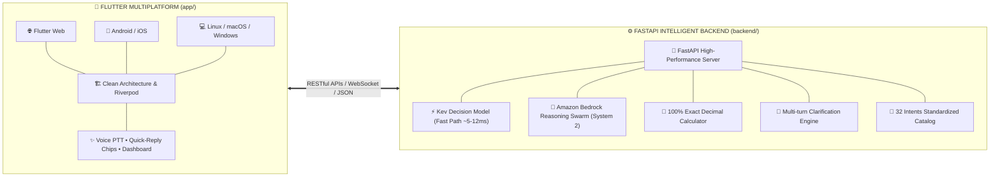
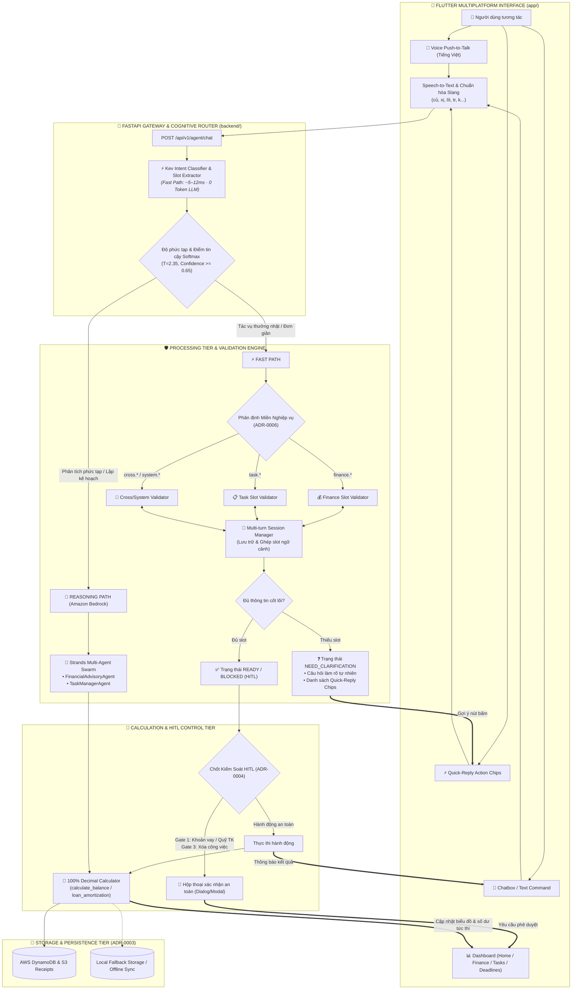

# OnisAgent – Trợ Lý AI Cá Nhân Hợp Nhất Quản Lý Tài Chính & Công Việc
> **AI Agent for Personal Task and Financial Management (Monorepo Ecosystem)**  
> Dự án tham dự Cuộc thi **Da Nang AI4Life** – Trường Đại học Công nghệ Thông tin và Truyền thông Việt - Hàn (VKU), Đại học Đà Nẵng.

[](https://www.python.org/)
[](https://fastapi.tiangolo.com/)
[](https://flutter.dev/)
[](https://opensource.org/licenses/MIT)
[](#-kiến-trúc-nhận-thức-hai-luồng-dual-path-kết-hợp-giao-diện-flutter-ui)
[](#-kiến-trúc-nhận-thức-hai-luồng-dual-path-kết-hợp-giao-diện-flutter-ui)
[](#-nguyên-tắc-kiến-trúc-cốt-lõi-adr-matrix)
[-blueviolet.svg)](#-bản-đặc-tả-toàn-diện-32-intent-catalog-4-nhóm)

---

## 👥 Nhóm Tác Giả & Đơn Vị Dự Thi

Dự án được nghiên cứu, thiết kế và phát triển bởi sinh viên **Trường Đại học Công nghệ Thông tin và Truyền thông Việt - Hàn (VKU) – Đại học Đà Nẵng** tham gia cuộc thi đổi mới sáng tạo ứng dụng trí tuệ nhân tạo **Da Nang AI4Life**:

* **Trịnh Quyết Chiến** – MSSV: `23IT.B019` – Lớp: `23JIT` – Email: `chientq.23itb@vku.udn.vn`  
  *Phụ trách:* Lõi AI Agent, FastAPI Server, Kev Decision Model (System 1 - Fast Path), Amazon Bedrock Reasoning Swarm (System 2), 100% Decimal Calculator, Bộ chuẩn hóa Slot Validator & Multi-turn Clarification Engine.
* **Hứa Huỳnh Anh** – MSSV: `23IT.B002` – Lớp: `23JIT` – Email: `anhhh.23itb@vku.udn.vn`  
  *Phụ trách:* Ứng dụng Flutter Multiplatform (Web, Android, iOS, Desktop), Kiến trúc Clean Architecture & State Management (Riverpod), Hệ thống Dashboard Tài chính & Công việc, Voice Push-to-Talk (PTT), Quick-Reply Action Chips, DynamoDB & S3 Storage và chốt kiểm soát Human-in-the-Loop (HITL).

---

## 🎯 Vấn Đề Thực Tiễn & Giải Pháp Đột Phá

Trong nhịp sống hiện đại bận rộn, người dùng cá nhân (đặc biệt là sinh viên, freelancer và người đi làm trẻ) thường xuyên đối mặt với **3 rào cản lớn**:
1. **Dữ liệu phân mảnh trầm trọng (Data Silos):** Thu chi theo dõi ở một ứng dụng (Money Lover, Spendee), công việc/deadline theo dõi ở ứng dụng khác (Todoist, Notion, Google Calendar), ghi chú ở ứng dụng thứ ba. Sự phân mảnh làm đứt gãy mối liên hệ giữa thời gian, năng suất và ngân sách.
2. **Ma sát nhập liệu thủ công (Manual Friction):** Thao tác 6–8 bước chạm để ghi nhận một khoản chi tiêu 45k hay một việc cần làm khiến hơn **85% người dùng từ bỏ sau 1–2 tuần**.
3. **Bẫy ảo giác số học và độ trễ cao của AI Chatbot thông thường (LLM Hallucination & Latency):** Việc phó mặc toàn bộ câu thoại cho LLM tính toán thường dẫn đến độ trễ cao (1.5–4 giây), tốn chi phí token và tiềm ẩn nguy cơ ảo giác, tính sai số dư tài chính hoặc trễ deadline quan trọng.

### 💡 Giải Pháp Đột Phá Từ OnisAgent:
* **Hợp nhất không gian sống (Unified Life Workspace):** Đồng bộ hoàn hảo giữa **Miền Tài Chính (Finance)** và **Miền Công Việc (Task)** trong một hệ sinh thái duy nhất.
* **Kiến trúc nhận thức hai luồng (Dual-Path Cognitive Architecture):**
  * **Fast Path (System 1 / Kev Decision Model):** Xử lý phản xạ tức thì (**~5–12 ms**, **0 Token LLM**) cho 85% tác vụ lặp lại (ghi thu chi, tạo việc, tra cứu số dư, xem deadline).
  * **Reasoning Path (System 2 / Amazon Bedrock Swarm):** Phân tích chiến lược tài chính chuyên sâu, cảnh báo rủi ro dòng tiền và lập kế hoạch làm việc thông minh.
* **Triết lý chống ảo giác số học:** *"Models reason, software computes"* – LLM chỉ đảm nhiệm suy luận ngôn ngữ ngữ cảnh; mã nguồn Python sử dụng `Decimal` thuần túy trên Local Tools & AWS Lambda đảm bảo độ chính xác tuyệt đối **100%**.
* **Cơ chế Hội thoại Làm Rõ Thông Minh (Multi-turn Clarification Dialog - ADR-0006):** Không bao giờ ghi nhận dữ liệu rác hay mơ hồ. Khi thiếu thông tin cốt lõi (như số tiền, danh mục, hạn chót), app chủ động hỏi lại lịch sự và cung cấp các nút chọn nhanh (Quick-Reply Action Chips).
* **Chốt kiểm duyệt an toàn Human-in-the-Loop (HITL - ADR-0004):** Bắt buộc người dùng phê duyệt trực tiếp trên giao diện trước các hành động nhạy cảm (áp dụng lịch trả góp nợ, cam kết quỹ tiết kiệm, xóa task vĩnh viễn).

---

## 🌐 Hệ Sinh Thái Monorepo Toàn Diện

OnisAgent được quy hoạch theo mô hình Monorepo chuyên nghiệp, phân tách rạch ròi giữa phân hệ Backend thông minh và Frontend đa nền tảng:



### 1. Phân Hệ Backend (`backend/`)
* **FastAPI Core Service:** Cung cấp API bất đồng bộ (asyncio) với tốc độ cao, hỗ trợ Pydantic V2 schema validation nghiêm ngặt.
* **Kev Decision Model (Fast Path):** Pipeline học máy cục bộ (TF-IDF + TruncatedSVD + MLPClassifier/Calibrated Softmax) nhận diện intent và trích xuất slot chỉ trong **~5–12ms** với chi phí **0 token LLM**.
* **Amazon Bedrock Reasoning Swarm (System 2):** Điều phối đa agent chuyên trách (`FinancialAdvisoryAgent`, `AnalysisAgent`, `TaskManagerAgent`) sử dụng Strands Agents SDK cho các tác vụ phân tích dòng tiền chuyên sâu.
* **Deterministic Decimal Calculator:** Module tính toán tài chính độc lập (`calculate_balance`, `calculate_loan_amortization`) sử dụng 100% kiểu `Decimal` của Python, triệt tiêu sai số float và ảo giác số học.
* **Catalog 32 Intent Chuẩn Hóa:** Bao phủ toàn diện đời sống người dùng trên 4 nhóm intent: Tài chính, Công việc, Giao thoa tiền - việc và Hệ thống.
* **Multi-turn Clarification Engine:** Quản lý phiên làm việc đa lượt (`SessionManager`, `SlotValidator`), duy trì ngữ cảnh và tự động kích hoạt `NEED_CLARIFICATION` khi thiếu thông tin.

### 2. Phân Hệ Frontend (`app/`)
* **Flutter Multiplatform:** Một mã nguồn duy nhất chạy mượt mà trên **Web**, **Android**, **iOS**, **Linux**, **macOS**, và **Windows**.
* **Clean Architecture & Riverpod:** Tách biệt ranh giới rõ ràng giữa Presentation, Domain, Data layer và quản lý trạng thái phản ứng hiện đại.
* **Chatbot Tương Tác Tự Nhiên (AI Assistant Screen):** Giao diện trò chuyện sống động, phản hồi tức thì với tin nhắn dạng bong bóng, hỗ trợ kết quả Fast Path và phân tích chuyên sâu.
* **Quick-Reply Action Chips:** Hiển thị trực quan các nút lựa chọn nhanh khi bot yêu cầu làm rõ (vd: chọn số tiền, chọn danh mục, chọn tài khoản ví, chọn thời hạn).
* **Voice Push-to-Talk (PTT):** Nhấn giữ để nói tiếng Việt tự nhiên, hệ thống nhận diện từ lóng tài chính ("củ", "xị", "lít", "tr", "k") và tự động điền vào khung chat.
* **Dashboard Tài Chính & Công Việc:**
  * **Màn hình Tổng Quan (Home):** Tóm tắt số dư tức thì, thống kê thu/chi tháng, công việc ưu tiên và các mốc deadline trong 24 giờ tới.
  * **Màn hình Tài Chính (Finance):** Quản lý ví, biểu đồ chi tiêu trực quan (`fl_chart`), lịch sử giao dịch và kế hoạch quỹ tiết kiệm.
  * **Màn hình Công Việc (Tasks):** Danh sách việc làm phân loại theo Ma trận Eisenhower (Khẩn cấp, Cao, Bình thường, Thấp).
  * **Màn hình Hạn Chót (Deadlines):** Bộ đếm ngược thời gian động với cảnh báo trực quan (`🔥 Cần hoàn tất gấp`).

---

## 🧠 Kiến Trúc Nhận Thức Hai Luồng (Dual-Path) Kết Hợp Giao Diện Flutter UI

Sơ đồ thể hiện chu trình xử lý nhận thức từ thao tác của người dùng trên ứng dụng Flutter đến tầng phân loại nhận thức, xử lý nghiệp vụ và phản hồi hiển thị:



---

## 📑 Bản Đặc Tả Toàn Diện 32 Intent Catalog (4 Nhóm)

Hệ thống OnisAgent quy chuẩn toàn bộ hành vi của người dùng vào **32 Intent nghiệp vụ** được phân loại rõ ràng thành 4 nhóm:

### 💰 1. Miền Tài Chính (Finance Domain – 14 Intents)

| STT | Mã Intent Chuẩn | Tên Hành Động / Nghiệp Vụ | Tuyến Nhận Thức | Chốt HITL | Slots Bắt Buộc |
| :---: | :--- | :--- | :---: | :---: | :--- |
| **1** | `finance.get_balance` | Tra cứu số dư ví / tài sản hiện có | **Fast Path** (~5-12ms) | Không | *Không* (fallback `account="all"`) |
| **2** | `finance.add_expense` | Ghi nhận chi tiêu thường nhật | **Fast Path** (~5-12ms) | Gate 2 | `amount`, (`category` hoặc `note`) |
| **3** | `finance.add_income` | Ghi nhận nguồn thu nhập mới | **Fast Path** (~5-12ms) | Không | `amount` |
| **4** | `finance.transfer` | Chuyển tiền giữa các ví / Nạp rút ATM | **Fast Path** (~5-12ms) | Không | `amount`, `from_account`, `to_account` |
| **5** | `finance.record_debt` | Ghi sổ nợ / cho mượn tiền | **Fast Path** (~5-12ms) | Gate 2 | `amount`, `person`, `debt_type` |
| **6** | `finance.debt_repay` | Trả nợ / Ghi nhận thu nợ về | **Fast Path** (~5-12ms) | Không | `amount`, `person` |
| **7** | `finance.split_bill` | Chia tiền hóa đơn nhóm / tiệc tùng | **Fast Path** + Decimal | Không | `total_amount`, `members_count` |
| **8** | `finance.pay_bill` | Đóng tiền hóa đơn định kỳ (điện, nước, trọ) | **Fast Path** (~5-12ms) | Không | `amount`, `bill_type` |
| **9** | `finance.query_transactions` | Tra cứu / Lọc lịch sử chi tiêu theo kỳ | **Fast Path** (~5-12ms) | Không | *Không* (fallback `time_range="this_month"`) |
| **10** | `finance.budget_plan` | Thiết lập hạn mức chi tiêu / ngân sách | **Reasoning Path** (Bedrock) | Gate 1 | `limit_amount` |
| **11** | `finance.update_budget` | Điều chỉnh hạn mức ngân sách đã có | **Fast Path** (~5-12ms) | Gate 1 | `category`, `limit_amount` |
| **12** | `finance.loan_installment_plan` | Bảng khấu hao trả góp dư nợ giảm dần | **Fast Path** + Decimal | Gate 1 | `principal`, `term_months`, `annual_rate` |
| **13** | `finance.savings_goal` | Tạo mục tiêu / quỹ tiết kiệm | **Fast Path** (~5-12ms) | Gate 1 | `goal_name`, `target_amount` |
| **14** | `finance.financial_report` | Báo cáo tài chính & phân tích chuyên sâu | **Reasoning Path** (Bedrock) | Không | *Không* (fallback `period="this_month"`) |

### 📋 2. Miền Công Việc & Thời Gian (Task Domain – 13 Intents)

| STT | Mã Intent Chuẩn | Tên Hành Động / Nghiệp Vụ | Tuyến Nhận Thức | Chốt HITL | Slots Bắt Buộc |
| :---: | :--- | :--- | :---: | :---: | :--- |
| **15** | `task.create` | Thêm công việc / Việc cần làm | **Fast Path** (~5-12ms) | Không | `title` |
| **16** | `task.create_recurring` | Công việc / Thói quen lặp lại theo chu kỳ | **Fast Path** (~5-12ms) | Không | `title`, `frequency` |
| **17** | `task.query_today` | Danh sách việc hôm nay / Kế hoạch ngày | **Fast Path** (~5-12ms) | Không | *Không* (fallback `date_filter="today"`) |
| **18** | `task.query_deadline` | Cảnh báo / Tra cứu hạn chót deadline gấp | **Fast Path** (~5-12ms) | Không | *Không* (fallback `range="upcoming_48h"`) |
| **19** | `task.query_by_tag` | Lọc việc theo nhãn / dự án (AI4Life, cá nhân) | **Fast Path** (~5-12ms) | Không | `tag` |
| **20** | `task.query_completed` | Xem lại các công việc đã hoàn thành | **Fast Path** (~5-12ms) | Không | *Không* |
| **21** | `task.schedule_event` | Lịch hẹn / Cuộc họp có mốc giờ cụ thể | **Fast Path** (~5-12ms) | Không | `title`, `start_time` |
| **22** | `task.reschedule` | Dời lịch / Đổi hạn chót / Hoãn deadline | **Fast Path** (~5-12ms) | Không | `new_deadline`, (`title` hoặc `task_id`) |
| **23** | `task.plan_schedule` | Lập kế hoạch ngày/tuần (Eisenhower Matrix) | **Reasoning Path** (Bedrock) | Không | `time_frame` |
| **24** | `task.complete` | Đánh dấu hoàn thành việc | **Fast Path** (~5-12ms) | Không | `title` hoặc `task_id` |
| **25** | `task.cancel` | Tạm hoãn / Hủy việc (vẫn lưu lịch sử) | **Fast Path** (~5-12ms) | Không | `title` hoặc `task_id` |
| **26** | `task.delete` | Xóa vĩnh viễn công việc | **Fast Path** (~5-12ms) | **Gate 3 (BLOCKED)** | `title` hoặc `task_id` |
| **27** | `task.search` | Tìm kiếm công việc theo từ khóa | **Fast Path** (~5-12ms) | Không | `keyword` |

### 🔗 3. Giao Thoa Tiền & Việc (Cross-Domain – 2 Intents)

| STT | Mã Intent Chuẩn | Tên Hành Động / Nghiệp Vụ | Tuyến Nhận Thức | Chốt HITL | Slots Bắt Buộc |
| :---: | :--- | :--- | :---: | :---: | :--- |
| **28** | `cross.plan_expense_task` | Kế hoạch công việc gắn dự trù kinh phí | **Reasoning Path** (Bedrock) | Gate 1 | `title`, `estimated_cost` |
| **29** | `cross.bill_due_reminder` | Nhắc hạn thanh toán hóa đơn kèm số tiền | **Fast Path** (~5-12ms) | Không | `bill_name`, `amount`, `due_date` |

### ⚙️ 4. Miền Hệ Thống (System Domain – 3 Intents)

| STT | Mã Intent Chuẩn | Tên Hành Động / Nghiệp Vụ | Tuyến Nhận Thức | Chốt HITL | Slots Bắt Buộc |
| :---: | :--- | :--- | :---: | :---: | :--- |
| **30** | `system.greeting_summary` | Chào buổi sáng & Tóm tắt số dư + top task | **Fast Path** (~5-12ms) | Không | *Không* |
| **31** | `system.help` | Hướng dẫn khả năng & câu lệnh mẫu | **Fast Path** (~5-12ms) | Không | *Không* |
| **32** | `system.undo` | Hoàn tác thao tác vừa thực hiện | **Fast Path** (~5-12ms) | Gate 2 | *Không* |

---

## 🏛️ Nguyên Tắc Kiến Trúc Cốt Lõi (ADR Matrix)

Hệ thống được thiết kế theo 6 văn kiện kiến trúc chính thức nằm tại thư mục [docs/adr/](file:///home/trinhquyetchien/Projects/Main/Team/OnisAgent/docs/adr/):

| Mã ADR | Tiêu Đề Kiến Trúc | Quyết Định Trọng Tâm |
| :---: | :---|:---|
| [**ADR-0001**](file:///home/trinhquyetchien/Projects/Main/Team/OnisAgent/docs/adr/ADR-0001-decimal-money-calculation.md) | **Deterministic Decimal Money Calculation** | Tính toán 100% bằng Python `Decimal` trên AWS Lambda; triệt tiêu hoàn toàn sai số dấu phẩy động và ảo giác số học của LLM. |
| [**ADR-0002**](file:///home/trinhquyetchien/Projects/Main/Team/OnisAgent/docs/adr/ADR-0002-dual-path-architecture-swarm.md) | **Dual-Path Architecture & Multi-Agent Swarm** | Fast Path phản xạ ~5–12ms cho 85% tác vụ thường nhật; Reasoning Path qua Amazon Bedrock & Strands Multi-Agent Swarm cho phân tích sâu. |
| [**ADR-0003**](file:///home/trinhquyetchien/Projects/Main/Team/OnisAgent/docs/adr/ADR-0003-dynamodb-s3-hybrid-storage.md) | **DynamoDB & S3 Hybrid Storage** | Lưu trữ NoSQL tốc độ cao cho 4 thực thể (`Transactions`, `Tasks`, `Sessions`, `SavingsGoals`) + S3 cho hóa đơn; đồng bộ offline an toàn qua local storage. |
| [**ADR-0004**](file:///home/trinhquyetchien/Projects/Main/Team/OnisAgent/docs/adr/ADR-0004-human-in-the-loop-workflow.md) | **Human-in-the-Loop (HITL) Workflow** | *"AI Proposes, Human Disposes"* – 3 Chốt phê duyệt an toàn: **Gate 1** (Khoản vay & Quỹ tiết kiệm), **Gate 2** (Đính chính phân loại), **Gate 3** (Xóa task / thao tác rủi ro cao). |
| [**ADR-0005**](file:///home/trinhquyetchien/Projects/Main/Team/OnisAgent/docs/adr/ADR-0005-voice-first-pipeline.md) | **Voice-First Two-Way Vietnamese Speech Pipeline** | Giao tiếp hai chiều bằng giọng nói tiếng Việt tự nhiên; Click-to-Talk & Push-to-Talk; ngân sách trễ $\le 2$ giây; xử lý tiếng lóng tài chính ("củ", "xị", "lít", "tr"). |
| [**ADR-0006**](file:///home/trinhquyetchien/Projects/Main/Team/OnisAgent/docs/adr/ADR-0006-domain-split-intent-slot-clarification.md) | **Domain Split, Schemas & Clarification Dialog Flow** | Phân tách 2 miền `finance.*` và `task.*`, xác thực Pydantic V2, quản lý ngữ cảnh đa lượt (Multi-turn), tự động kích hoạt `NEED_CLARIFICATION` khi thiếu thông tin. |

---

## 📂 Cấu Trúc Monorepo Dự Án

```
OnisAgent/
├── backend/                           # ⚙️ Phân hệ Backend: FastAPI, Kev Model & Bedrock Swarm
│   ├── docs/                          # Tài liệu đặc tả kỹ thuật (intent_catalog.md,...)
│   ├── src/                           # Mã nguồn chính của Backend
│   │   ├── agents/                    # Strands Multi-Agent Swarm (Advisory, Analysis, Categorization)
│   │   ├── config.py                  # Cấu hình hệ thống, nạp biến môi trường
│   │   ├── database/                  # DynamoDB Client & Local Storage Fallback
│   │   ├── engine/                    # SlotValidator & Multi-turn SessionManager
│   │   ├── models/kev/                # Pipeline huấn luyện & suy luận Kev Decision Model
│   │   ├── schemas/                   # Pydantic V2 Schemas (base, common, finance, task)
│   │   ├── tools/                     # Deterministic Decimal Calculator & AWS Lambda handlers
│   │   └── utils/                     # Trình ghi log và bộ phân tích dữ liệu
│   ├── data/                          # Dữ liệu huấn luyện Kev Model (clean, raw, splits)
│   ├── scripts/                       # Scripts thu thập dữ liệu và huấn luyện mô hình cục bộ
│   ├── tests/                         # Bộ kiểm thử tự động (pytest)
│   ├── requirements.txt               # Thư viện phụ thuộc Python
│   ├── .env.example                   # Tệp cấu hình biến môi trường mẫu
│   └── README.md                      # Hướng dẫn kỹ thuật chi tiết Backend
│
├── app/                               # 📱 Phân hệ Frontend: Flutter Multiplatform App
│   ├── lib/                           # Mã nguồn chính của ứng dụng Flutter
│   │   ├── models/                    # Data models (Transaction, Task, Budget, Goal...)
│   │   ├── screens/                   # Các màn hình chính (Home, Finance, Tasks, Deadlines, Assistant)
│   │   ├── services/                  # State management & Mock Data Service
│   │   ├── theme/                     # Dark theme hiện đại (Slate & Indigo)
│   │   ├── widgets/                   # Các UI components tái sử dụng
│   │   └── main.dart                  # Điểm khởi chạy ứng dụng (Hỗ trợ Responsive Web/Mobile)
│   ├── web/                           # Cấu hình triển khai nền tảng Web
│   ├── pubspec.yaml                   # Thư viện phụ thuộc Flutter (fl_chart, intl, google_fonts...)
│   └── test/                          # Widget tests
│
├── docs/                              # 📚 Tài liệu kiến trúc dự án
│   └── adr/                           # 6 bản Architecture Decision Records (ADR-0001 -> ADR-0006)
└── README.md                          # Tài liệu tổng quan toàn bộ hệ thống Monorepo
```

---

## 🚀 Hướng Dẫn Cài Đặt & Khởi Chạy Hệ Thống

### 1. Chuẩn Bị Môi Trường
* **Python:** Phiên bản `3.11` hoặc `3.12`.
* **Flutter SDK:** Phiên bản `3.41` trở lên (kèm trình duyệt Google Chrome hoặc máy ảo Android/iOS).
* **Git:** Quản lý mã nguồn.

---

### 2. Cài Đặt & Khởi Chạy Backend (`backend/`)

Mở terminal tại thư mục gốc của dự án:

```bash
# 1. Di chuyển vào thư mục backend
cd backend

# 2. Tạo và kích hoạt môi trường ảo Python
python3 -m venv .venv
source .venv/bin/activate    # Trên Linux/macOS
# .venv\Scripts\Activate.ps1 # Trên Windows PowerShell

# 3. Cài đặt các thư viện phụ thuộc
pip install -r requirements.txt

# 4. Thiết lập biến môi trường
cp .env.example .env

# 5. Khởi chạy FastAPI Server (mặc định tại cổng 8000)
uvicorn src.main:app --reload --host 0.0.0.0 --port 8000
```

> **API Documentation:** Sau khi khởi chạy, truy cập tài liệu Swagger UI tương tác tại: `http://localhost:8000/docs`.

---

### 3. Cài Đặt & Khởi Chạy Frontend Flutter (`app/`)

Mở terminal mới:

```bash
# 1. Di chuyển vào thư mục app
cd app

# 2. Cài đặt các gói phụ thuộc Flutter
flutter pub get

# 3. Khởi chạy trên Trình duyệt Web (Chrome)
flutter run -d chrome

# 4. Hoặc khởi chạy trên Thiết bị di động / Máy ảo / Desktop
flutter run
```

*Ứng dụng tự động điều chỉnh layout thông minh:*
* **Desktop / Web:** Hiển thị Sidebar Navigation mở rộng kèm các biểu đồ trực quan đa cột.
* **Mobile (Android/iOS):** Tối ưu hóa với Bottom Navigation Bar, thao tác vuốt mượt mà và Voice Push-to-Talk (PTT) tiện lợi.

---

### 4. Chạy Kiểm Thử Tự Động (Automated Testing with Pytest)

Hệ thống được trang bị bộ unit test kiểm thử toàn diện logic nghiệp vụ, tính toán tiền tệ Decimal và luồng hội thoại đa lượt:

```bash
# Di chuyển vào thư mục backend
cd backend

# Kích hoạt môi trường ảo
source .venv/bin/activate

# Chạy toàn bộ test suites cốt lõi (Slot Validator, Session Manager, Decimal Calculator)
PYTHONPATH=. pytest tests/test_slot_validator.py tests/test_session_manager.py tests/test_tools.py -v
```

**Kết quả kỳ vọng:**
* `test_slot_validator.py`: Xác thực hoàn hảo việc nhận diện trường bắt buộc, tự động gán giá trị mặc định và kích hoạt trạng thái `NEED_CLARIFICATION`.
* `test_session_manager.py`: Kiểm thử thành công khả năng duy trì ngữ cảnh đa lượt, ghép nối (`merge`) slot thông minh và xử lý chuyển đổi intent (`intent switch`).
* `test_tools.py`: Xác nhận độ chính xác **100%** của phép tính `Decimal`, không có sai số dấu phẩy động và bảng khấu hao nợ chuẩn xác từng đồng.

---

## 📄 Bản Quyền & Giấy Phép (License)

Dự án được phát hành theo giấy phép [MIT License](LICENSE).  
Bản quyền © 2026 thuộc về **Nhóm tác giả OnisAgent** – Cuộc thi **Da Nang AI4Life** (Trường Đại học Công nghệ Thông tin và Truyền thông Việt - Hàn – Đại học Đà Nẵng).
