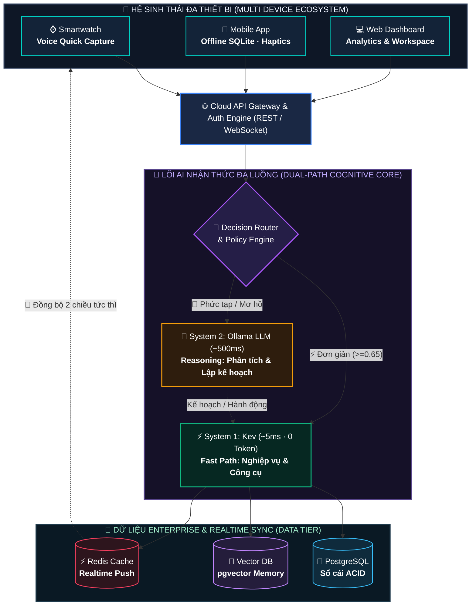
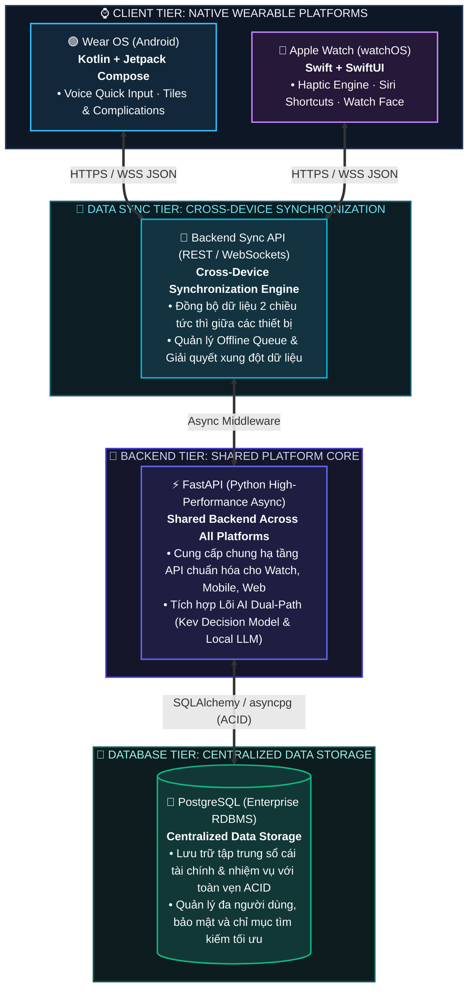

<div align="center">

# ⚡ OnisAgent
### Trợ Lý AI Cá Nhân Nhận Thức Đa Luồng (Dual-Path AI Architecture)
**Quản Lý Tài Chính & Năng Suất Cá Nhân Đa Nền Tảng: Wear OS · Apple Watch · Mobile · Web**

[](https://python.org)
[](https://fastapi.tiangolo.com)
[](https://github.com/jaredpalmer/kev)
[](https://ollama.ai)
[](LICENSE)
[](#-2-kiến-trúc-ai-nhận-thức-đa-luồng-dual-path)

<p align="center">
  <b>Tốc độ phản xạ ~5ms (0 Token)</b> cho 85% tác vụ thu chi & công việc thường nhật.<br/>
  <b>Suy luận chiến lược sâu qua Local LLM</b> với <b>0% ảo giác số liệu</b> nhờ cơ chế Grounded Context.
</p>

[🚀 Khởi Chạy Nhanh](#-5-hướng-dẫn-cài-đặt--khởi-chạy) • [📐 Kiến Trúc 1:1](#-2-kiến-trúc-ai-nhận-thức-đa-luồng-dual-path) • [⌚ Tech Stack Đa Nền Tảng](#-3-hệ-sinh-thái-tech-stack-đa-thiết-bị) • [📚 Thư Viện Docs](docs/) • [🎤 Slide Thuyết Trình](docs/PRESENTATION_SLIDES.md)

---
</div>

## 📖 Mục Lục
1. [Vấn Đề & Triết Lý Giải Pháp](#-1-vấn-đề--triết-lý-giải-pháp)
2. [Kiến Trúc AI Nhận Thức Đa Luồng (Dual-Path Core)](#-2-kiến-trúc-ai-nhận-thức-đa-luồng-dual-path)
3. [Hệ Sinh Thái Tech Stack Đa Thiết Bị](#-3-hệ-sinh-thái-tech-stack-đa-thiết-bị)
4. [Cấu Trúc Thư Mục Decoupled](#-4-cấu-trúc-thư-mục-dự-án)
5. [Hướng Dẫn Cài Đặt & Khởi Chạy](#-5-hướng-dẫn-cài-đặt--khởi-chạy)
6. [Hệ Sinh Thái 22 Công Cụ & Kịch Bản Demo](#-6-hệ-sinh-thái-công-cụ--kịch-bản-demo)
7. [Tài Liệu Kỹ Thuật (Docs Hub)](#-7-thư-viện-tài-liệu-kỹ-thuật-docs)
8. [Đo Đạc Hiệu Năng & Tiết Kiệm Token](#-8-đo-đạc-hiệu-năng--tiết-kiệm-token)

---

## 🎯 1. Vấn Đề & Triết Lý Giải Pháp

### 3 Nghịch Lý Của Ứng Dụng Quản Lý Cá Nhân & Trợ Lý AI Hiện Nay:
1. **Dữ liệu phân mảnh:** Thu chi ở app này, việc cần làm (to-do) ở app khác, ghi chú ở app thứ ba ➔ Người dùng mất cái nhìn liên kết giữa tài chính và thời gian.
2. **Ma sát nhập liệu thủ công (Manual Input Friction):** Ghi một khoản nhỏ 35.000đ tiền trà sữa phải qua 6–8 bước chạm màn hình ➔ Hơn **85% người dùng bỏ cuộc** sau 2 tuần.
3. **Bẫy lãng phí LLM (LLM Overkill & Hallucination):** Đẩy 100% câu lệnh vào LLM sinh văn bản đắt đỏ gây độ trễ cao (1.500 – 4.000ms), tốn chi phí token và tiềm ẩn nguy cơ **ảo giác số học** (tính sai tiền, sai số dư).

### 💡 Lời Giải OnisAgent: Mô Hình Single-Agent Nhận Thức Đa Luồng (Dual-Path)
Lấy cảm hứng từ lý thuyết nhận thức đoạt giải Nobel của Daniel Kahneman (*Thinking, Fast and Slow*):
* **⚡ Phản xạ nhanh (System 1 - Kev Decision Model):** Xử lý tức thì các câu lệnh quy tắc trong **5–12ms, 0 Token**, độ chính xác 100%.
* **🧠 Tư duy sâu (System 2 - Local Ollama LLM):** Kích hoạt suy luận xu hướng và lập kế hoạch chiến lược với **Grounded Context Injection** bảo đảm **0% ảo giác**.

---

## 🧠 2. Kiến Trúc AI Nhận Thức Đa Luồng (Dual-Path)

Sơ đồ kiến trúc toàn diện theo **tỷ lệ vuông vức 1:1 chuẩn hóa**, kết nối từ thiết bị biên qua Cổng API đến Lõi AI và Tầng lưu trữ dữ liệu Enterprise:



---

## ⌚ 3. Hệ Sinh Thái Tech Stack Đa Thiết Bị

Kiến trúc phân tầng công nghệ đồng bộ giữa thiết bị đeo tay thông minh và cụm máy chủ trung tâm:



| Phân Tầng | Công Nghệ / Framework | Ngôn Ngữ & Thư Viện | Vai Trò Kỹ Thuật |
| :--- | :--- | :--- | :--- |
| **⌚ Wear OS** | Wear OS by Google | `Kotlin` + `Jetpack Compose for Wear OS` | Voice Quick Capture, Tile Services, tối ưu pin màn hình tròn. |
| **🍎 Apple Watch** | watchOS by Apple | `Swift` + `SwiftUI for watchOS` | Trải nghiệm 60fps mượt mà, phản hồi rung Haptic, Complications widget. |
| **🔄 Data Sync** | Cross-Device Sync API | `FastAPI WebSocket / Polling & SSE` | Đồng bộ dữ liệu hai chiều thời gian thực; tự động bù khi có mạng (Offline-First). |
| **🚀 Shared Backend** | FastAPI Core | `Python 3.12+ (Async ASGI)` | **Dùng chung cho mọi nền tảng**; độ trễ microsecond; tích hợp Kev & LLM. |
| **💾 Central Storage**| PostgreSQL Core | `SQLAlchemy` + `asyncpg` | **Sổ cái tập trung**; giao dịch ACID tuyệt đối không thất thoát dữ liệu. |

---

## 📂 4. Cấu Trúc Thư Mục Dự Án

Dự án được cấu trúc tách bạch 100% giữa **Backend**, **Frontend** và **Tài liệu**:

```
OnisAgent/
├── 📂 docs/                                  # 📚 TOÀN BỘ TÀI LIỆU KỸ THUẬT & SLIDE
│   ├── README.md                          # Mục lục tra cứu tài liệu
│   ├── PRESENTATION_SLIDES.md             # 16 Slide thuyết trình pitch deck (Kiến trúc 1:1)
│   ├── MODEL_TRAINING_AND_DATASET_GUIDE.md # Cẩm nang thu thập dữ liệu & train PhoBERT/Kev/Qwen
│   ├── onisagent_architecture_flow.drawio # Sơ đồ luồng quyết định chi tiết Draw.io
│   └── OnisAgent_Project_Overview.html    # Bản đặc tả thiết kế gốc tương tác
│
├── 📂 backend/                               # 🚀 DỊCH VỤ FASTAPI BACKEND ĐỘC LẬP
│   ├── app/
│   │   ├── main.py                        # Entrypoint, CORS middleware & REST API
│   │   ├── config.py                      # Cấu hình môi trường (Kev, Ollama, DB)
│   │   ├── router.py                      # Lõi điều phối Dual-Path & Policy Engine
│   │   ├── kev_client.py                  # Client Kev Decision Model (/v1/systemone)
│   │   ├── ollama_client.py               # Client Ollama Local LLM (qwen2.5:3b)
│   │   ├── tools.py                       # 22 Công cụ nghiệp vụ (Finance, Tasks, Savings...)
│   │   └── db.py                          # Lớp truy xuất cơ sở dữ liệu
│   ├── data/
│   │   └── onis_db.json                   # Sổ cái CSDL lưu trữ
│   ├── requirements.txt                   # Thư viện phụ thuộc Python
│   ├── run_backend.sh                     # Script chạy backend độc lập (Port 8000)
│   └── README.md                          # Hướng dẫn chi tiết cho backend
│
├── 📂 frontend/                              # 🌐 DỊCH VỤ WEB CLIENT ĐỘC LẬP
│   ├── index.html                         # Giao diện Cyber Dark Dashboard
│   ├── css/style.css                      # Bộ stylesheet giao diện tối trực quan
│   ├── js/app.js                          # State management, realtime telemetry & CORS API
│   ├── js/voice.js                        # Bộ điều khiển Web Speech API (STT & TTS)
│   ├── package.json                       # Cấu hình script chạy
│   ├── run_frontend.sh                    # Script chạy web frontend độc lập (Port 3000)
│   └── README.md                          # Hướng dẫn chi tiết cho frontend
│
└── 📜 start_demo.sh                          # 🚀 Script khởi chạy 1-click toàn bộ hệ thống
```

---

## 🚀 5. Hướng Dẫn Cài Đặt & Khởi Chạy

### 5.1. Yêu Cầu Môi Trường
* **Hệ điều hành:** Linux / macOS / Windows (WSL2)
* **Python:** 3.12+ (đã có `uv` hoặc `pip`)
* **Local LLM (Tùy chọn cho Reasoning Path):** [Ollama](https://ollama.ai) chạy tại `http://localhost:11434` với model `qwen2.5:3b` hoặc `gemma3:latest`.

---

### 5.2. Lựa Chọn 1: Khởi Động Trọn Gói 1-Click (Khuyên Dùng Cho Demo)
```bash
./start_demo.sh 8000
```
Script sẽ tự động khởi tạo virtualenv, cài đặt thư viện và mở máy chủ tại:  
👉 **`http://localhost:8000`**

---

### 5.3. Lựa Chọn 2: Khởi Chạy Độc Lập Frontend & Backend (Production Mode)

1. **Khởi chạy Backend (Terminal 1 - Port 8000):**
   ```bash
   ./backend/run_backend.sh 8000
   ```
   *Kiểm tra API docs Swagger tại: `http://localhost:8000/docs`*

2. **Khởi chạy Frontend (Terminal 2 - Port 3000):**
   ```bash
   ./frontend/run_frontend.sh 3000
   ```
   *Mở trình duyệt tại: `http://localhost:3000` (Frontend tự động kết nối API backend qua CORS)*

---

## 🛠️ 6. Hệ Sinh Thái Công Cụ & Kịch Bản Demo

Hệ thống cung cấp **22 công cụ nghiệp vụ** chia làm 6 trụ cột cốt lõi:

| Nhóm Nghiệp Vụ | Công Cụ Chính | Nhánh Xử Lý | Khả Năng Thực Thi |
| :--- | :--- | :---: | :---: |
| **💰 Quản Lý Tài Chính** | `create_expense`, `create_income`, `query_transactions`, `get_summary`, `set_budget` | ⚡ Fast Path | 🎙️ Nói / 🖱️ Form UI |
| **🧮 Máy Tính Khoản Vay** | `calculate_loan` (Tính trả góp gốc + lãi theo kỳ hạn) | ⚡ Fast Path | 🎙️ Nói / 🖱️ Widget Tab |
| **🎯 Quỹ Tiết Kiệm** | `create_goal`, `deposit_goal`, `delete_goal` | ⚡ Fast Path | 🎙️ Nói / 🖱️ Cards Tab |
| **📝 Quản Lý Công Việc** | `create_task`, `complete_task`, `delete_task`, `query_tasks` | ⚡ Fast Path | 🎙️ Nói / 🖱️ Checklist |
| **⏰ Lời Nhắc & Bộ Nhớ** | `create_reminder`, `save_note`, `query_memory` | ⚡ Fast Path | 🎙️ Nói / 🖱️ Notes Tab |
| **🧠 Cố Vấn & Lập Lịch** | `analyze_spending`, `plan_day` | 🧠 Reasoning | 🎙️ Nói / 💬 AI Chat |

### 🎙️ Kịch Bản Thử Nghiệm Trực Tiếp:
* **Chi tiêu siêu tốc (Fast Path ~5ms):**  
  > *"Chi 35k tiền trà sữa"* hoặc *"Đổ xăng xe máy hết 5 chục"*  
  ➔ Kev nhận diện `transaction.create_expense`, trừ ngân sách và xác nhận bằng giọng nói ngay lập tức.
* **Tính toán khoản vay (Fast Path ~5ms):**  
  > *"Tính vay 50 triệu trong 12 tháng lãi suất 10%"*  
  ➔ Tính toán chi tiết tiền gốc + lãi trả góp từng tháng.
* **Tạo nhiệm vụ (Fast Path ~5ms):**  
  > *"Thêm task hoàn thiện slide họp 9h sáng mai mức ưu tiên cao"*  
  ➔ Tự động bóc tách deadline và gán cờ `high priority`.
* **Phân tích suy luận tài chính (Reasoning Path ~500ms):**  
  > *"Vì sao tháng này tôi chi tiêu nhiều hơn bình thường?"*  
  ➔ Ollama LLM đọc dữ liệu thật từ DB, chỉ rõ danh mục chi tiêu lớn nhất và đưa ra lời khuyên thiết thực.

---

## 📚 7. Thư Viện Tài Liệu Kỹ Thuật (`docs/`)

Toàn bộ tài liệu hỗ trợ nghiên cứu và triển khai được gom gọn tại [`docs/`](docs/):

* 🎤 **[docs/PRESENTATION_SLIDES.md](docs/PRESENTATION_SLIDES.md)**: 16 slide thuyết trình hoàn chỉnh (Vấn đề, Giải pháp, Công nghệ 1:1, Tính năng) sẵn sàng đưa vào PowerPoint/Keynote.
* 🧠 **[docs/MODEL_TRAINING_AND_DATASET_GUIDE.md](docs/MODEL_TRAINING_AND_DATASET_GUIDE.md)**: Cẩm nang thu thập dữ liệu khẩu ngữ tiếng Việt, huấn luyện PhoBERT / Kev (ONNX 3.5ms) và Qwen2.5:3B QLoRA SFT (GGUF Ollama).
* 📐 **[docs/onisagent_architecture_flow.drawio](docs/onisagent_architecture_flow.drawio)**: File Draw.io luồng rẽ nhánh chi tiết.
* 🌐 **[docs/OnisAgent_Project_Overview.html](docs/OnisAgent_Project_Overview.html)**: Bản đặc tả thiết kế tương tác nguyên bản.
* 📑 **[docs/README.md](docs/README.md)**: Trang mục lục tổng hợp tài liệu.

---

## 📊 8. Đo Đạc Hiệu Năng & Tiết Kiệm Token

| Tiêu Chí Đánh Giá | Trợ Lý Truyền Thống (Chỉ dùng LLM Cloud) | OnisAgent (Dual-Path Single-Agent) | Lợi Ích Trực Tiếp |
| :--- | :---: | :---: | :--- |
| **Tốc độ phản hồi** | ❌ Chậm (1.500 – 4.000 ms) | ⚡ **Siêu tốc (5 – 12 ms)** | Đàm thoại giọng nói tức thì, không bị khựng |
| **Độ chính xác số học** | ⚠️ Nguy cơ ảo giác số liệu | 🎯 **100% Chính xác** | Code Python chuyên biệt thực thi phép tính |
| **Chi phí Token LLM** | 💸 Đắt đỏ (100% qua LLM) | 💰 **Tiết kiệm ~85% Token** | System 1 xử lý 0 Token; chỉ gọi LLM khi cần |
| **Bảo mật & Quyền riêng tư** | ⚠️ Rủi ro gửi dữ liệu lên cloud | 🛡️ **Bảo mật tuyệt đối** | Chạy 100% On-Device / Local Server |

---

## 📄 9. Bản Quyền & Giấy Phép (License)
Dự án được phân phối dưới giấy phép **Apache-2.0 License**.  
Tham khảo thêm kiến trúc mô hình ra quyết định [Kev](https://github.com/jaredpalmer/kev.git) bởi Jared Palmer.
