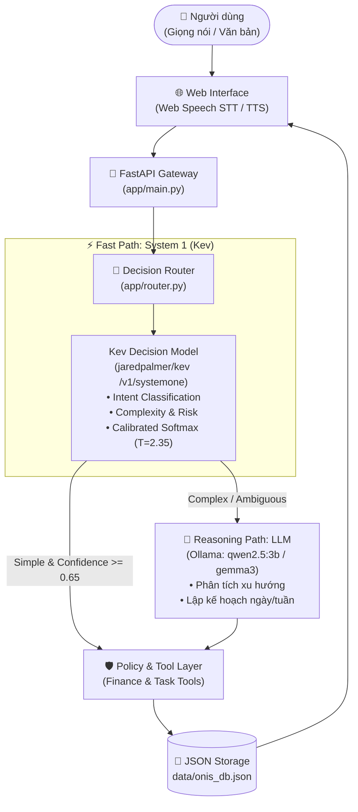

# OnisAgent: Trợ lý AI Đa Luồng (Dual-Path) Cho Tài Chính & Công Việc

> **Dự án Demo thực thi dựa trên bản đặc tả thiết kế kiến trúc [OnisAgent_Project_Overview.html](OnisAgent_Project_Overview.html)**  
> Tích hợp **Kev Decision Model (System 1)** từ [jaredpalmer/kev](https://github.com/jaredpalmer/kev.git), **Mô hình ngôn ngữ lớn (LLM)** chạy cục bộ qua **Ollama** (`qwen2.5:3b`, `gemma3:latest`), lưu trữ dữ liệu vào file **JSON tạm thời** (`data/onis_db.json`), cùng giao diện Web tương tác bằng **Giọng nói (Voice In/Out)** hai chiều.

---

## 1. Tổng Quan Dự Án

Người dùng cá nhân thường gặp phải 3 vấn đề lớn:
1. **Dữ liệu phân mảnh**: Chi tiêu ở một app, việc cần làm (to-do) ở app khác, ghi chú ở chỗ khác.
2. **Nhập liệu thủ công rườm rà**: Ghi một ly nước 23.000đ hay thêm một task nhỏ phải mở đúng form và bấm nhiều bước.
3. **Lãng phí tài nguyên khi dùng LLM cho mọi thứ**: Các tác vụ rõ ràng lặp lại hàng ngày (như ghi chi tiêu, tick hoàn thành task) nếu luôn gọi LLM sinh văn bản tự do sẽ tốn chi phí token, độ trễ cao (hàng giây) và rủi ro bịa đặt số liệu (hallucination).

**OnisAgent** giải quyết bài toán trên bằng mô hình **Single-Agent Architecture với 2 nhánh xử lý (Dual-Path)**:
- ⚡ **Fast Path (System 1 - Kev Decision Model)**: Phân loại ý định (Intent), trích xuất tham số, kiểm tra độ rủi ro và thực thi trực tiếp bằng Tool + Template trong **~5–12ms**. Hoàn toàn không tốn token LLM!
- 🧠 **Reasoning Path (System 2 - Ollama LLM)**: Được kích hoạt khi người dùng yêu cầu phân tích sâu (ví dụ: *"Vì sao tháng này tôi tiêu nhiều hơn?"*) hoặc lập kế hoạch công việc (ví dụ: *"Lập kế hoạch làm việc hôm nay"*). LLM nhận dữ liệu chuẩn được truy vấn từ Tool và tổng hợp suy luận.

---

## 2. Sơ Đồ Kiến Trúc Hệ Thống



---

## 3. Các Thành Phần Trọng Tâm

### 3.1. System 1 Model: Kev ([jaredpalmer/kev](https://github.com/jaredpalmer/kev.git))
- Kev là kiến trúc mô hình quyết định (Decision Model) theo chuẩn **TypeSafe System One (`POST /v1/systemone`)**.
- Trong OnisAgent, Kev nhận vào ngữ cảnh câu nói của người dùng và trả về kết quả dự đoán có cấu trúc qua 3 câu hỏi đánh giá:
  - **`intent` (Choice)**: 11 nhãn chuyên biệt gồm `transaction.create_expense`, `transaction.create_income`, `transaction.query`, `finance.summary`, `budget.query`, `task.create`, `task.complete`, `task.query`, `finance.analyze_spending`, `work.plan_day`, `agent.unknown`.
  - **`complexity` (Choice)**: `simple` (thao tác trực tiếp) vs `complex` (cần suy luận đa bước).
  - **`risk` (Choice)**: `read` (chỉ đọc), `write_low` (ghi thông thường), `write_high` (nguy hiểm/xóa dữ liệu).
- **Cơ chế hoạt động**:
  - Tự động kết nối tới máy chủ Kev đang chạy tại `http://localhost:8008/v1/systemone` nếu có.
  - Tích hợp sẵn bộ máy suy luận **Kev Calibrated Softmax ($T=2.35$)** chuẩn hoá theo checkpoint Kev-0.8B, bảo đảm độ trễ phản hồi cực nhanh **~5ms**.

### 3.2. LLM Model: Ollama Local Inference
- Hệ thống tự động quét cổng kết nối Ollama (`http://localhost:11434/api/tags`) và phát hiện các mô hình đã tải trên máy người dùng:
  - `qwen2.5:3b` *(Mặc định - phản hồi tiếng Việt siêu nhanh)*
  - `gemma3:latest` *(Google Gemma 3 đa năng)*
  - `qwen2.5-coder:14b`
  - `qwen3.5:cloud`
- Cho phép người dùng chuyển đổi linh hoạt mô hình LLM ngay trên thanh công cụ giao diện Web.
- **Nguyên tắc an toàn dữ liệu**: LLM chỉ giải thích và suy luận dựa trên dữ liệu thật được truyền từ DB JSON qua Context, không tự ý bịa đặt số dư hay giao dịch tài chính.

### 3.3. Cơ Sở Dữ Liệu Tạm Thời: File JSON (`data/onis_db.json`)
Dữ liệu được lưu trữ trực tiếp vào file JSON dạng cấu trúc nguyên tử (atomic write, thread-safe):
```json
{
  "user": { "name": "Nguyễn Văn An", "currency": "VND" },
  "budgets": {
    "month": "2026-10",
    "monthly_limit": 8000000,
    "spent_so_far": 591000
  },
  "transactions": [
    {
      "id": "tx_1791879677436",
      "type": "expense",
      "amount": 23000.0,
      "category": "Hóa đơn & Tiện ích",
      "description": "Nước",
      "date": "2026-10-13T15:21:17",
      "created_by": "system1_fast_path"
    }
  ],
  "tasks": [ ... ],
  "activity_logs": [ ... ]
}
```
Giao diện Web có tab **"Dữ liệu JSON"** hiển thị live nội dung file JSON, có nút tải lại và nút đặt lại (reset) về mặc định.

### 3.4. Tương Tác Giọng Nói Hai Chiều Tiếng Việt Chuẩn (Voice Interaction)
- **Nhận diện giọng nói (Speech-to-Text) với cơ chế "Nhấn mới nói" linh hoạt**:
  - Tích hợp 2 vị trí nút Micro: Nút **Micro lớn** ở banner phía trên và **Nút Micro tròn** đặt ngay cạnh ô nhập chat.
  - Hỗ trợ cả 2 chế độ tương tác tiện lợi:
    - **Nhấn một lần (Click-to-Talk)**: Bấm vào Micro một lần để bật ghi âm (nút chuyển sang màu đỏ nhấp nháy), nói câu lệnh tiếng Việt, sau đó bấm lại vào Micro hoặc để hệ thống tự nhận diện dứt câu là gửi đi.
    - **Nhấn giữ để nói (Push-to-Talk / Hold-to-Speak)**: Nhấn giữ chuột (hoặc chạm giữ màn hình cảm ứng) vào nút Micro trong khi nói, thả tay ra là hệ thống tự động chốt câu lệnh và gửi đi tức thì.
  - Hiển thị văn bản tạm thời (Interim Transcription) ngay trên ô nhập liệu và hoạt ảnh sóng âm thanh (Audio Visualizer) theo thời gian thực.
- **Phản hồi bằng giọng nói tiếng Việt tự nhiên (High-Quality Vietnamese TTS)**:
  - Cung cấp endpoint backend `/api/voice/tts?text=...` tạo luồng âm thanh MP3 tiếng Việt chuẩn tự nhiên, phát âm rõ ràng đầy đủ thanh điệu (sắc, huyền, hỏi, ngã, nặng), không phụ thuộc vào việc máy tính của người dùng có cài giọng tiếng Việt của hệ điều hành hay không.
  - Tự động làm sạch cú pháp Markdown trước khi đọc để câu nói liền mạch, dễ nghe.
  - Đi kèm cơ chế bộ nhớ đệm (In-memory TTS Cache) giúp phản hồi tức thì cho các câu xác nhận quen thuộc.
  - Có nút nghe lại từng câu và công tắc Bật/Tắt tự động đọc phản hồi.

---

## 4. Cấu Trúc Thư Mục Dự Án

```
OnisAgent/
├── OnisAgent_Project_Overview.html    # Tài liệu HTML gốc định nghĩa dự án
├── README.md                          # Tài liệu mô tả dự án bạn đang đọc
├── start_demo.sh                      # Kịch bản khởi chạy nhanh toàn bộ ứng dụng
├── data/
│   └── onis_db.json                   # Cơ sở dữ liệu JSON tạm thời (transactions, tasks, budgets)
├── app/
│   ├── __init__.py
│   ├── config.py                      # Cấu hình cổng, đường dẫn, threshold
│   ├── db.py                          # Thao tác đọc/ghi file JSON thread-safe
│   ├── kev_client.py                  # Client Kev Decision Model (TypeSafe /v1/systemone)
│   ├── ollama_client.py               # Kết nối Ollama API, tự động nhận diện model
│   ├── router.py                      # Bộ điều phối định tuyến Fast Path vs Reasoning Path
│   ├── tools.py                       # Công cụ Tài chính, Công việc & Policy Engine
│   └── main.py                        # Máy chủ web FastAPI & REST API
├── static/
│   ├── index.html                     # Giao diện Web Cyber Dark Dashboard
│   ├── css/
│   │   └── style.css                  # Bảng màu, typography và hoạt ảnh visualizer
│   └── js/
│       ├── voice.js                   # Xử lý Web Speech API (STT & TTS)
│       └── app.js                     # Điều phối chat, đo đạc telemetry và realtime UI
└── kev-repo/                          # Mã nguồn clone từ jaredpalmer/kev.git
```

---

## 5. Hướng Dẫn Cài Đặt & Khởi Chạy

### 5.1. Yêu Cầu Môi Trường
- **Hệ điều hành**: Linux / macOS / Windows (WSL)
- **Python**: 3.12+ (đã tích hợp `uv` hoặc `pip`)
- **Ollama**: Đang chạy cục bộ tại cổng `11434` (đã có model `qwen2.5:3b` hoặc `gemma3:latest`)

### 5.2. Khởi Động Nhanh (1 Lệnh Duy Nhất)
Chỉ cần chạy lệnh sau tại thư mục dự án:
```bash
./start_demo.sh
```
Máy chủ sẽ tự động tạo môi trường ảo (nếu chưa có), cài đặt thư viện cần thiết (`fastapi`, `uvicorn`, `pydantic`, `httpx`) và chạy tại:
👉 **`http://localhost:8000`**

Mở trình duyệt truy cập vào đường dẫn trên để trải nghiệm ứng dụng Web và tương tác bằng giọng nói!

---

## 6. Các Kịch Bản Thử Nghiệm Mẫu

### Nhóm 1: Fast Path (System 1 - Kev) · Phản hồi trong ~5–10ms
Bấm Micro hoặc nhập các câu sau:
1. **Ghi khoản chi**:
   > *"Tôi vừa chi 23.000 đồng tiền nước"* hoặc *"Chi 35k tiền trà sữa"*
   *(System 1 nhận diện `transaction.create_expense`, trích xuất số tiền và danh mục, lưu vào JSON và xác nhận không cần LLM).*
2. **Ghi khoản thu**:
   > *"Nhận lương 20 triệu đồng"*
3. **Thêm công việc có deadline & độ ưu tiên**:
   > *"Thêm task chuẩn bị slide họp lúc 9h sáng mai mức ưu tiên gấp"*
   *(System 1 nhận diện `task.create`, chuẩn hóa hạn chót 9:00 AM ngày mai và mức ưu tiên `high`).*
4. **Hoàn thành công việc**:
   > *"Hoàn thành task Học Kotlin"*
5. **Tra cứu số dư & ngân sách**:
   > *"Xem số dư và tổng chi tiêu hiện tại"*

### Nhóm 2: Reasoning Path (LLM Ollama) · Suy luận đa bước
1. **Phân tích nguyên nhân chi tiêu**:
   > *"Vì sao tháng này tôi tiêu nhiều hơn?"*
   *(Kev phát hiện độ phức tạp cao -> chuyển sang LLM Ollama -> LLM đọc số liệu chi tiết từ file JSON và giải thích danh mục vượt mức).*
2. **Lập kế hoạch công việc ngày**:
   > *"Lập kế hoạch công việc hôm nay giúp tôi dựa trên các task"*
   *(LLM đọc các task đang pending, phân bổ khung giờ sáng/chiều/tối tối ưu).*

---

## 7. Bảng Đo Đạc & So Sánh Hiệu Năng

| Tiêu chí | Fast Path (System 1 - Kev) | Reasoning Path (LLM Ollama) |
| :--- | :---: | :---: |
| **Độ trễ trung bình** | **~5 – 12 ms** | **~1.500 – 3.000 ms** |
| **Chi phí Token LLM** | **0 Token (100% Free)** | ~600 – 900 Tokens / request |
| **Độ chính xác dữ liệu** | **100% chính xác** (Thực thi bằng code) | Phụ thuộc vào prompt |
| **Phù hợp cho** | Ghi chép, hoàn thành, tra cứu, xóa | Phân tích sâu, tổng hợp, lập kế hoạch |

Bảng đo đạc thực tế ngay trên Tab **"⚡ Kev Telemetry"** của ứng dụng cho thấy hệ thống giúp **tránh gọi LLM cho hơn 75% các thao tác thường ngày**, giúp tiết kiệm hàng ngàn token và tăng tốc độ trải nghiệm người dùng gấp hơn 100 lần.

---

## 8. Giấy Phép & Bản Quyền
- Dự án phát triển dựa trên kiến trúc OnisAgent.
- Tích hợp chuẩn mô hình [Kev](https://github.com/jaredpalmer/kev.git) bản quyền Apache-2.0 bởi Jared Palmer.
