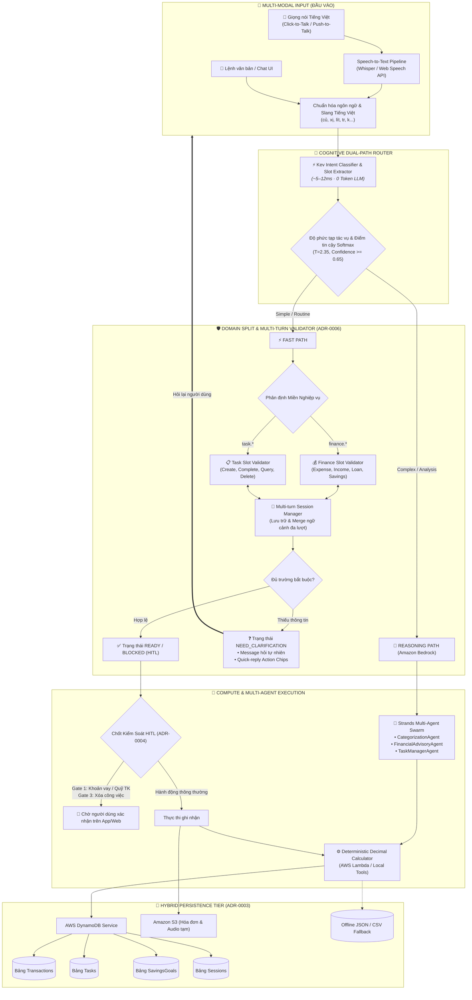

# OnisAgent – Trợ Lý AI Cá Nhân Hợp Nhất Quản Lý Tài Chính & Công Việc
> **AI Agent for Personal Task and Financial Management (Monorepo Ecosystem)**  
> Dự án tham dự Cuộc thi **Da Nang AI4Life** – Trường Đại học Công nghệ Thông tin và Truyền thông Việt - Hàn (VKU), Đại học Đà Nẵng.

[](https://www.python.org/)
[](https://flutter.dev/)
[](https://opensource.org/licenses/MIT)
[](#-kiến-trúc-hệ-thống-dual-path-cognitive-architecture)
[](#-kiến-trúc-hệ-thống-dual-path-cognitive-architecture)
[](#nguyên-tắc-kiến-trúc-cốt-lõi-adr-matrix)
[-blueviolet.svg)](#-kiến-trúc-luồng-dữ-liệu-hai-miền-adr-0006)

---

## 👥 Nhóm Tác Giả & Phân Công Trách Nhiệm

* **Trịnh Quyết Chiến** – MSSV: `23IT.B019` – Lớp: `23JIT` – Email: `chientq.23itb@vku.udn.vn`  
  *Phụ trách:* Lõi AI Agent, Amazon Bedrock, Strands Agents SDK Swarm, Kev Decision Model, Bộ chuẩn hóa Slot Validator & Clarification Engine, và mô hình điều phối nhận thức Dual-Path.
* **Hứa Huỳnh Anh** – MSSV: `23IT.B002` – Lớp: `23JIT` – Email: `anhhh.23itb@vku.udn.vn`  
  *Phụ trách:* Cơ sở dữ liệu DynamoDB & S3 Hybrid Storage, Ứng dụng Flutter Multiplatform (Web & Mobile), Speech Pipeline (STT/TTS) và chốt kiểm soát Human-in-the-Loop (HITL).

---

## 🎯 Vấn Đề Thực Tiễn & Giải Pháp Đột Phá

Trong quản lý cuộc sống hằng ngày, người dùng cá nhân thường xuyên đối mặt với **3 rào cản lớn**:
1. **Dữ liệu phân mảnh trầm trọng:** Thu chi theo dõi ở một ứng dụng (Money Lover, Spendee), công việc/deadline theo dõi ở ứng dụng khác (Todoist, Notion), ghi chú ở ứng dụng thứ ba khiến mất hoàn toàn sự liên kết giữa thời gian, năng suất và ngân sách.
2. **Ma sát nhập liệu thủ công (Manual Friction):** Việc phải thực hiện từ 6–8 thao tác chạm chỉ để ghi một khoản chi 45k hay một việc cần làm khiến hơn **85% người dùng bỏ cuộc sau 1–2 tuần**.
3. **Bẫy ảo giác số học của AI Chatbot thông thường (LLM Hallucination):** Việc giao toàn bộ câu thoại cho LLM tính toán thường dẫn đến độ trễ cao (1.5–4s), tốn token và tiềm ẩn nguy cơ ảo giác, tính sai số dư tài chính hoặc trễ deadline quan trọng.

### 💡 Giải Pháp Đột Phá Từ OnisAgent:
* **Hợp nhất không gian sống (Unified Life Workspace):** Tích hợp hoàn hảo giữa **Miền Tài Chính (Finance)** và **Miền Công Việc (Task)** trong một hệ sinh thái duy nhất.
* **Kiến trúc nhận thức hai luồng (Dual-Path Cognitive Architecture):**
  * **Fast Path (System 1 / Kev Decision Model):** Xử lý phản xạ tức thì (**~5–12 ms**, **0 Token LLM**) cho 85% tác vụ lặp lại (thêm thu chi, tạo việc, tra cứu số dư).
  * **Reasoning Path (System 2 / Amazon Bedrock / Ollama LLM):** Phân tích chiến lược dòng tiền chuyên sâu, dự toán khoản vay và lập kế hoạch ngày/tuần.
* **Triết lý chống ảo giác số học:** *"Models reason, software computes"* – LLM chỉ đảm nhiệm suy luận ngôn ngữ ngữ cảnh; mã nguồn Python sử dụng `Decimal` thuần túy trên AWS Lambda & Local Tools chịu trách nhiệm tính toán với độ chính xác tuyệt đối **100%**.
* **Cơ chế Hội thoại Làm Rõ Thông Minh (Multi-turn Clarification Dialog - ADR-0006):** Không bao giờ ghi nhận dữ liệu rác hay mơ hồ. Khi thiếu thông tin cốt lõi (như số tiền, tài khoản ví, hạn chót), app chủ động hỏi lại lịch sự và cung cấp các nút chọn nhanh (Quick-reply action chips).
* **Chốt kiểm duyệt an toàn Human-in-the-Loop (HITL - ADR-0004):** Bắt buộc người dùng phê duyệt trực tiếp trước các hành động nhạy cảm (áp dụng lịch trả góp nợ, cam kết quỹ tiết kiệm, xóa task).

---

## 🧠 Kiến Trúc Luồng Dữ Liệu Hai Miền (ADR-0006)

Hệ thống phân tách rạch ròi giữa hai miền nghiệp vụ từ tầng nhận thức, xác thực slot cho tới lưu trữ:



---

## 🏛️ Nguyên Tắc Kiến Trúc Cốt Lõi (ADR Matrix)

Hệ thống được thiết kế theo 6 văn kiện kiến trúc chính thức nằm tại [docs/adr/](file:///home/trinhquyetchien/Projects/Main/Team/OnisAgent/docs/adr/):

| Mã ADR | Tiêu Đề Kiến Trúc | Quyết Định Trọng Tâm |
| :---: | :---|:---|
| [**ADR-0001**](file:///home/trinhquyetchien/Projects/Main/Team/OnisAgent/docs/adr/ADR-0001-decimal-money-calculation.md) | **Deterministic Decimal Money Calculation** | Tính toán 100% bằng Python `Decimal` trên AWS Lambda; triệt tiêu hoàn toàn sai số dấu phẩy động và ảo giác số học của LLM. |
| [**ADR-0002**](file:///home/trinhquyetchien/Projects/Main/Team/OnisAgent/docs/adr/ADR-0002-dual-path-architecture-swarm.md) | **Dual-Path Architecture & Multi-Agent Swarm** | Fast Path phản xạ 5–12ms cho 85% tác vụ lặp lại; Reasoning Path qua Amazon Bedrock & Strands Multi-Agent Swarm cho phân tích sâu. |
| [**ADR-0003**](file:///home/trinhquyetchien/Projects/Main/Team/OnisAgent/docs/adr/ADR-0003-dynamodb-s3-hybrid-storage.md) | **DynamoDB & S3 Hybrid Storage** | Lưu trữ NoSQL tốc độ cao cho 4 thực thể (`Transactions`, `Tasks`, `Sessions`, `SavingsGoals`) + S3 cho hóa đơn; đồng bộ offline qua local file. |
| [**ADR-0004**](file:///home/trinhquyetchien/Projects/Main/Team/OnisAgent/docs/adr/ADR-0004-human-in-the-loop-workflow.md) | **Human-in-the-Loop (HITL) Workflow** | *"AI Proposes, Human Disposes"* – 3 Chốt phê duyệt an toàn: **Gate 1** (Khoản vay & Quỹ tiết kiệm), **Gate 2** (Đính chính phân loại), **Gate 3** (Xóa task / thao tác rủi ro cao). |
| [**ADR-0005**](file:///home/trinhquyetchien/Projects/Main/Team/OnisAgent/docs/adr/ADR-0005-voice-first-pipeline.md) | **Voice-First Two-Way Vietnamese Speech Pipeline** | Giao tiếp hai chiều bằng giọng nói tiếng Việt tự nhiên; Click-to-Talk & Push-to-Talk; ngân sách trễ $\le 2$ giây; xử lý tiếng lóng tài chính. |
| [**ADR-0006**](file:///home/trinhquyetchien/Projects/Main/Team/OnisAgent/docs/adr/ADR-0006-domain-split-intent-slot-clarification.md) | **Domain Split, Schemas & Clarification Dialog Flow** | Phân tách 2 miền `finance.*` và `task.*`, xác thực Pydantic V2, quản lý ngữ cảnh đa lượt (Multi-turn), tự động kích hoạt `NEED_CLARIFICATION` khi thiếu thông tin. |

---

## 🌟 Bộ Tính Năng Chính Của Hệ Thống

### 💰 1. Miền Quản Lý Tài Chính (Finance Domain)
* **Ghi nhận thu chi siêu tốc:** Hỗ trợ nhập liệu bằng văn bản hoặc giọng nói tự nhiên với từ lóng (vd: *"chi 45k trà sữa"*, *"vừa nhận lương 20 củ"*).
* **Tra cứu số dư đa tài khoản:** Kiểm tra số dư tức thì theo từng ví (Ví tiền mặt, Ngân hàng, Momo) hoặc tổng tài sản.
* **Công cụ tính toán khoản vay dư nợ giảm dần:** Mô phỏng lịch khấu hao trả góp gốc và lãi từng tháng chính xác 100% bằng `Decimal`.
* **Quản lý mục tiêu & quỹ tiết kiệm:** Đặt mục tiêu tích lũy, theo dõi tiến độ hoàn thành kèm lời nhắc thông minh.
* **Cố vấn tài chính chuyên sâu (System 2):** Phân tích cơ cấu chi tiêu, cảnh báo bội chi và tư vấn tối ưu hóa ngân sách.

### 📋 2. Miền Quản Lý Công Việc & Deadline (Task Domain)
* **Ghi nhận công việc & nhắc hẹn:** Tạo task nhanh chóng kèm deadline (vd: *"nhắc tôi nộp slide đồ án lúc 17h chiều mai"*).
* **Ma trận ưu tiên Eisenhower:** Tự động gắn nhãn và phân loại mức độ ưu tiên: *Khẩn cấp*, *Ưu tiên cao*, *Bình thường*, *Thấp*.
* **Bộ đếm ngược Deadline động:** Cảnh báo các mốc thời gian sắp hết hạn trong vòng 24 giờ tới (`🔥 Cần hoàn tất gấp`).
* **Hoàn thành và dọn dẹp task:** Đánh dấu hoàn thành việc hoặc xóa task (được bảo vệ bởi chốt HITL Gate 3).

### 🔄 3. Cơ Chế Hội Thoại Làm Rõ Đa Lượt (Multi-turn Clarification Dialog)
* **Không lưu dữ liệu rác:** Nếu người dùng chỉ nói *"vừa mua đồ"* (thiếu số tiền) hay *"tạo task giúp"* (thiếu tên việc), hệ thống chuyển sang trạng thái `NEED_CLARIFICATION`.
* **Gợi ý chọn nhanh (Quick-Reply Chips):** Trả về câu hỏi làm rõ tự nhiên bằng Tiếng Việt kèm các nút gợi ý trên UI để người dùng chạm 1 chạm là xong.
* **Giữ ngữ cảnh thông minh:** Tự động lưu các slot đã nhận diện ở lượt trước và ghép (`merge`) thông tin bổ sung ở lượt sau mà không cần bắt người dùng nhập lại từ đầu.

---

## 📂 Cấu Trúc Monorepo Dự Án

Dự án được tổ chức theo mô hình **Monorepo** chuẩn mực, phân tách rõ ràng giữa Core Backend và Multiplatform App:

```
OnisAgent/
├── backend/                           # ⚙️ Python Backend, Kev Model & Multi-Agent Engine
│   ├── src/                           # Source code nghiệp vụ
│   │   ├── schemas/                   # Pydantic V2 Schemas (base, finance, task)
│   │   ├── engine/                    # SlotValidator & Multi-turn SessionManager
│   │   ├── agents/                    # Strands Multi-Agent Swarm (Advisory, Analysis, Categorization)
│   │   ├── tools/                     # Python Decimal Calculator & AWS Lambda handlers
│   │   ├── models/kev/                # Kev Decision Model Pipeline & Inference Wrapper
│   │   ├── database/                  # DynamoDB Client & Local Storage
│   │   └── config.py                  # Cấu hình hệ thống & môi trường
│   ├── data/                          # Dataset huấn luyện Kev Model (clean, raw, splits)
│   ├── scripts/                       # Scripts tiền xử lý dữ liệu và huấn luyện mô hình
│   ├── tests/                         # Unit tests (test_slot_validator, test_session_manager, test_tools...)
│   ├── requirements.txt               # Danh sách thư viện Python
│   ├── .env.example                   # Cấu hình mẫu môi trường backend
│   └── README.md                      # 👉 Tài liệu kỹ thuật chi tiết Backend
│
├── app/                               # 📱 Ứng dụng Flutter Multiplatform (Web & Mobile)
│   ├── lib/                           # Mã nguồn ứng dụng Flutter
│   │   ├── screens/                   # Các màn hình chính (Home, Finance, Tasks, Deadlines, Assistant)
│   │   ├── widgets/                   # Các UI Components tái sử dụng
│   │   ├── models/                    # Data models ứng dụng
│   │   ├── services/                  # Quản lý state & Mock Data Service
│   │   ├── theme/                     # Dark theme hiện đại (Slate/Indigo)
│   │   └── main.dart                  # Điểm khởi chạy ứng dụng (Hỗ trợ Responsive Web/Mobile)
│   ├── web/                           # Cấu hình và tài nguyên Web App
│   ├── pubspec.yaml                   # Thư viện phụ thuộc Flutter (fl_chart, intl, google_fonts...)
│   └── test/                          # Widget tests
│
├── docs/                              # 📚 Tài liệu dự án
│   ├── intent_catalog.md              # 🎯 Đặc tả chi tiết toàn bộ Intent & Slot Schema
│   └── adr/                           # Hệ thống Architecture Decision Records (ADR-0001 -> ADR-0006)
│       ├── ADR-0001-decimal-money-calculation.md
│       ├── ADR-0002-dual-path-architecture-swarm.md
│       ├── ADR-0003-dynamodb-s3-hybrid-storage.md
│       ├── ADR-0004-human-in-the-loop-workflow.md
│       ├── ADR-0005-voice-first-pipeline.md
│       ├── ADR-0006-domain-split-intent-slot-clarification.md
│       └── README.md                  # ADR Matrix
│
└── README.md                          # Tài liệu tổng quan toàn bộ dự án
```

---

## 🚀 Hướng Dẫn Cài Đặt & Khởi Chạy Toàn Bộ Dự Án

### 1. Chuẩn Bị Môi Trường
* **Python:** Phiên bản `3.11` trở lên.
* **Flutter:** Phiên bản `3.41` trở lên (kèm môi trường Chrome hoặc Android Emulator).

---

### 2. Khởi Chạy Backend (`backend/`)

```bash
# 1. Di chuyển vào thư mục backend
cd backend

# 2. Tạo và kích hoạt môi trường ảo
python3 -m venv .venv
source .venv/bin/activate    # Trên Linux/macOS
# .venv\Scripts\Activate.ps1 # Trên Windows PowerShell

# 3. Cài đặt các thư viện phụ thuộc
pip install -r requirements.txt

# 4. Thiết lập biến môi trường
cp .env.example .env

# 5. Chạy bộ kiểm thử tự động xác thực hệ thống
PYTHONPATH=. pytest tests/test_slot_validator.py tests/test_session_manager.py tests/test_tools.py -v
```

> Chi tiết cấu hình và kiến trúc API Backend xem tại: [backend/README.md](file:///home/trinhquyetchien/Projects/Main/Team/OnisAgent/backend/README.md).

---

### 3. Khởi Chạy Ứng Dụng Flutter Multiplatform (`app/`)

Mở terminal mới:

```bash
# 1. Di chuyển vào thư mục app
cd app

# 2. Cài đặt các gói package Flutter
flutter pub get

# 3. Chạy ứng dụng trên Trình duyệt Web (Chrome)
flutter run -d chrome

# 4. Hoặc chạy trên Thiết bị di động / Giả lập
flutter run
```

Ứng dụng Flutter sẽ tự động nhận diện kích thước màn hình để hiển thị **Sidebar Navigation** thanh lịch trên Web/Desktop hoặc **Bottom Navigation Bar** tiện lợi trên Mobile.

---

## 📄 Bản Quyền & Giấy Phép (License)

Dự án được phát hành theo giấy phép [MIT License](LICENSE).  
Bản quyền thuộc về **Nhóm tác giả OnisAgent** – Cuộc thi **Da Nang AI4Life 2026** (VKU, Đại học Đà Nẵng).
