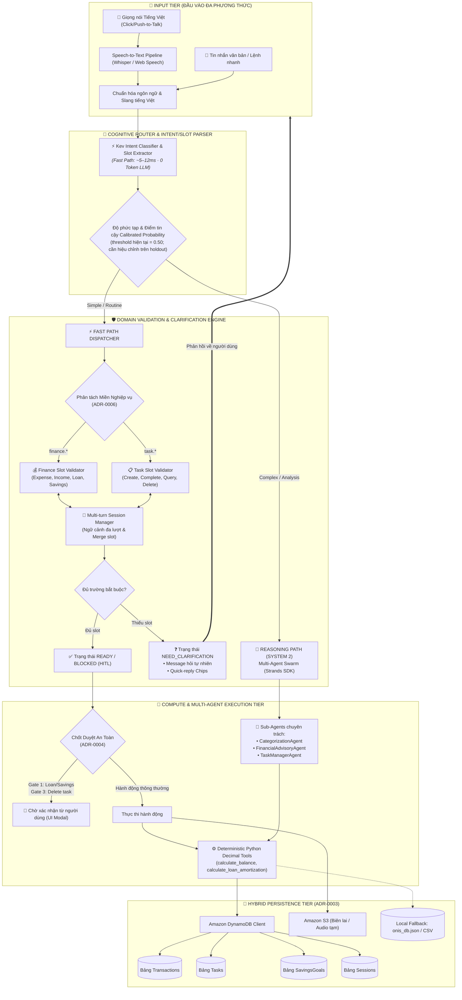

# OnisAgent Backend – Kiến Trúc Hệ Thống & Hướng Dẫn Phát Triển

> **AI Agent for Personal Task and Financial Management – Core Backend Engine**  
> Dự án tham dự Cuộc thi **Da Nang AI4Life** – Trường Đại học Công nghệ Thông tin và Truyền thông Việt - Hàn (VKU), Đại học Đà Nẵng.

[](https://www.python.org/)
[](https://docs.pydantic.dev/)
[](#1-thiết-kế-hệ-thống-tổng-thể-system-architecture)
[](#1-thiết-kế-hệ-thống-tổng-thể-system-architecture)
[](#nguyên-tắc-kiến-trúc-adr-matrix)
[](https://opensource.org/licenses/MIT)

## Tài liệu kỹ thuật mới

- [Kiến trúc Backend](docs/architecture.md)
- [Đặc tả API](docs/api-specification.md)
- [Schema dữ liệu](docs/database-schema.md)
- [Tích hợp AI](docs/ai-integration.md)
- [Kiến trúc Authentication](docs/architecture/authentication.md)
- [API Authentication](docs/api/authentication.md)
- [Schema Authentication](docs/database/schema.md)
- [ERD PostgreSQL](docs/database/erd.md)
- [Lịch sử migration](docs/database/migration-history.md)
- [Hướng dẫn migration](docs/development/database-migration-guide.md)

## Authentication setup

Configure PostgreSQL and authentication secrets in `.env`, then run:

```powershell
alembic upgrade head
python -m uvicorn src.main:app --host 127.0.0.1 --port 8000
```

## Docker development environment

Run these commands from the `backend/` directory. If `.env` does not exist, create
it from `.env.example` and replace the development password/secret placeholders.
Keep `POSTGRES_PASSWORD` and the password in `DATABASE_URL` identical. The existing
authentication settings are named `AUTH_SECRET`, `AUTH_ACCESS_TOKEN_MINUTES`, and
`AUTH_REFRESH_TOKEN_DAYS`; they are used by the current auth implementation.

```powershell
if (!(Test-Path .env)) { Copy-Item .env.example .env }
docker compose up -d --build
docker compose ps
docker compose logs -f
docker compose run --rm backend alembic upgrade head
```

The API is available at `http://localhost:8000`. Inside the backend container,
Compose sets `DATABASE_URL` to use the `db` service hostname. For a backend started
directly on the host, use `localhost` in `DATABASE_URL`. The `/health` endpoint
returns HTTP 503 when it cannot connect to the database.

Stop containers without deleting PostgreSQL data:

```powershell
docker compose down
```

> **Warning:** `docker compose down -v` removes the named PostgreSQL volume and all
> database data. Use it only when you explicitly intend to delete that data.

## API Mapping chính

| Frontend Screen | Thao tác | API |
|---|---|---|
| Đăng nhập/Đăng ký | Auth | `POST /api/v1/auth/register`, `POST /api/v1/auth/login` |
| Trợ lý AI | Chat và intent | `POST /api/v1/chat`, `POST /api/v1/intent/classify` |
| Tài chính | Danh sách/thêm/sửa/xóa giao dịch | `/api/v1/transactions` |
| Công việc | Danh sách/thêm/sửa công việc | `/api/v1/tasks` |
| Deadline | Xem công việc | `/api/v1/tasks?status=pending` |
| Quỹ tiết kiệm | Xem/tạo quỹ | `/api/v1/savings-goals` |
| Sổ nợ | Xem/tạo nợ | `/api/v1/debts` |
| Hành động nhạy cảm | Xác nhận | `POST /api/v1/hitl/approve` |

---

## 📑 Mục Lục
1. [Thiết Kế Hệ Thống Tổng Thể (System Architecture)](#1-thiết-kế-hệ-thống-tổng-thể-system-architecture)
2. [Đặc Tả Luồng Hoạt Động End-to-End (6 Kịch Bản Chi Tiết)](#-đặc-tả-luồng-hoạt-động-end-to-end-toàn-diện)
3. [Nguyên Tắc Kiến Trúc Cốt Lõi (ADR Matrix)](#2-nguyên-tắc-kiến-trúc-cốt-lõi-adr-matrix)
4. [Bản Đặc Tả Toàn Bộ Intent & Slot Schema (Full Intent-Slot Matrix)](#3-bản-đặc-tả-toàn-bộ-intent--slot-schema-full-intent-slot-matrix)
5. [Cơ Chế Hội Thoại Làm Rõ Đa Lượt (Multi-turn Clarification Dialog Flow)](#4-cơ-chế-hội-thoại-làm-rõ-đa-lượt-multi-turn-clarification-dialog-flow)
6. [Cấu Trúc Thư Mục & Vai Trò Các Module (Folder Structure & Module Reference)](#5-cấu-trúc-thư-mục--vai-trò-các-module)
7. [Hướng Dẫn Cài Đặt, Cấu Hình Môi Trường & Kiểm Thử](#6-hướng-dẫn-cài-đặt-cấu-hình-môi-trường--kiểm-thử)

---

### 🚀 Đặc Tả Luồng Hoạt Động End-to-End Toàn Diện
> Chi tiết tài liệu kiến trúc 5 tầng và 6 kịch bản hoạt động end-to-end (kèm sơ đồ Mermaid Sequence chi tiết):  
> 👉 Xem tại: **[backend/docs/end_to_end_flow.md](file:///home/trinhquyetchien/Projects/Main/Team/OnisAgent/backend/docs/end_to_end_flow.md)**  
> Bao quát:
> - **Kịch bản 1:** Fast Path hoàn chỉnh (~6-10ms, 0 Token).
> - **Kịch bản 2:** Hội thoại làm rõ đa lượt (Multi-turn Clarification Flow).
> - **Kịch bản 3:** Chốt an toàn Human-in-the-Loop (HITL Safety Gate).
> - **Kịch bản 4:** Reasoning Path (Phân tích chuyên sâu qua Ollama Local LLM `qwen2.5:3b`).
> - **Kịch bản 5:** Giao thoa tiền & việc (Cross-Domain: Dự định đi đâu gắn ngân sách).
> - **Kịch bản 6:** Xử lý ngoại lệ & dự phòng (Graceful Fallback & Recovery).

---

---

## 1. Thiết Kế Hệ Thống Tổng Thể (System Architecture)

OnisAgent Backend được thiết kế theo nguyên lý **Clean Architecture** kết hợp mô hình nhận thức hai luồng **Dual-Path Cognitive Architecture**. Hệ thống tách biệt hoàn toàn giữa tốc độ phản xạ tức thì (System 1 - Fast Path) và năng lực tư duy phân tích sâu (System 2 - Reasoning Path), đồng thời cô lập hai miền dữ liệu cốt lõi: **Miền Tài Chính (Finance Domain)** và **Miền Công Việc & Deadline (Task Domain)**.

### Sơ Đồ Kiến Trúc Luồng Dữ Liệu (End-to-End Dataflow)



---

## 2. Nguyên Tắc Kiến Trúc Cốt Lõi (ADR Matrix)

Hệ thống tuân thủ nghiêm ngặt 6 quyết định kiến trúc chuẩn hóa (**Architecture Decision Records**):

| Mã ADR | Tiêu Đề Quyết Định | Triết Lý / Nguyên Tắc Cốt Lõi | Ứng Dụng Trong Backend |
| :---: | :---|:---|:---|
| [**ADR-0001**](file:///home/trinhquyetchien/Projects/Main/Team/OnisAgent/docs/adr/ADR-0001-decimal-money-calculation.md) | **Deterministic Decimal Money Calculation** | *"Models reason, software computes"* – Không giao tính toán số học cho LLM. | 100% số liệu tiền tệ, lãi suất, khấu hao nợ sử dụng `Decimal` trong `src/tools/calculator.py` và AWS Lambda handlers. |
| [**ADR-0002**](file:///home/trinhquyetchien/Projects/Main/Team/OnisAgent/docs/adr/ADR-0002-dual-path-architecture-swarm.md) | **Dual-Path Cognitive Architecture & Swarm** | Phản xạ tức thì 5–12ms cho 85% tác vụ; suy luận sâu Grounded Context cho 15% tác vụ. | Kết hợp Kev Decision Model (Fast Path) và Amazon Bedrock / Ollama LLM điều phối qua Strands SDK Multi-Agent Swarm. |
| [**ADR-0003**](file:///home/trinhquyetchien/Projects/Main/Team/OnisAgent/docs/adr/ADR-0003-dynamodb-s3-hybrid-storage.md) | **DynamoDB & S3 Hybrid Storage** | Dữ liệu cấu trúc tốc độ cao trên NoSQL, tài nguyên phi cấu trúc trên Object Storage. | DynamoDB (`Transactions`, `Tasks`, `Sessions`, `SavingsGoals`) + S3 Receipts/Audio; fallback offline an toàn qua file cục bộ. |
| [**ADR-0004**](file:///home/trinhquyetchien/Projects/Main/Team/OnisAgent/docs/adr/ADR-0004-human-in-the-loop-workflow.md) | **Human-in-the-Loop (HITL) Workflow** | *"AI Proposes, Human Disposes"* – AI tham mưu đề xuất, Người dùng bấm duyệt. | 3 Chốt kiểm soát: **Gate 1** (khoản vay/quỹ tiết kiệm), **Gate 2** (sửa phân loại), **Gate 3** (xóa task / sửa số dư gốc). |
| [**ADR-0005**](file:///home/trinhquyetchien/Projects/Main/Team/OnisAgent/docs/adr/ADR-0005-voice-first-pipeline.md) | **Voice-First Two-Way Speech Pipeline** | Tương tác giọng nói tự nhiên, không ma sát, ngân sách trễ $\le 2$ giây. | Chuẩn hóa tiếng lóng tài chính Việt Nam ("củ", "xị", "lít", "tr"), tích hợp Whisper / Web Speech API & Neural TTS. |
| [**ADR-0006**](file:///home/trinhquyetchien/Projects/Main/Team/OnisAgent/docs/adr/ADR-0006-domain-split-intent-slot-clarification.md) | **Domain Split & Clarification Dialog Flow** | Phân tách rạch ròi 2 miền; chủ động hỏi lại lịch sự khi thiếu trường cốt lõi. | Chuẩn hóa tiền tố `finance.*` và `task.*`, xây dựng Pydantic V2 Schemas, `SlotValidator` và `SessionManager` xử lý đa lượt. |

---

## 3. Bản Đặc Tả Toàn Bộ Intent & Slot Schema (Full Intent-Slot Matrix)

Toàn bộ các Schema được định nghĩa bằng **Pydantic V2** với cơ chế xác thực trường kiểu dữ liệu nghiêm ngặt.
👉 *Xem tài liệu đặc tả đầy đủ kèm 100+ mẫu câu tiếng Việt tại: [docs/intent_catalog.md](docs/intent_catalog.md)*.

### 💰 3.1. Miền Tài Chính (Finance Domain – Tiền tố `finance.*`)

| Tên Intent | Mô tả nghiệp vụ | Trường BẮT BUỘC (Required) | Trường TÙY CHỌN (Optional) & Fallback | Trạng thái / Chốt kiểm duyệt |
| :--- | :--- | :--- | :--- | :--- |
| **`finance.get_balance`** / `finance.balance.query` | Tra cứu số dư ví hoặc tổng tài sản | *Không có* | • `account`: fallback `"all"`<br>• `period`: fallback `"current"` | `READY` (Fast Path ~5-12ms). |
| **`finance.add_expense`** / `finance.expense.create` | Ghi nhận một khoản chi tiêu mới | • `amount`: `Decimal` (> 0)<br>• Phải có ít nhất `category` hoặc `note` | • `account`: fallback `"default_account"`<br>• `date`: fallback `datetime.now()`<br>• `payment_method`: `None` | `READY` khi đủ slot. Thiếu `amount` $\rightarrow$ `NEED_CLARIFICATION` (HITL Gate 2). |
| **`finance.add_income`** / `finance.income.create` | Ghi nhận khoản thu nhập mới | • `amount`: `Decimal` (> 0) | • `source`: fallback `"Thu nhập khác"`<br>• `account`: fallback `"default_account"`<br>• `date`: fallback `datetime.now()` | `READY` khi đủ slot. Thiếu `amount` $\rightarrow$ `NEED_CLARIFICATION`. |
| **`finance.budget_plan`** | Kế hoạch chi tiêu / Ngân sách tháng/tuần | • `limit_amount`: `Decimal` (> 0) | • `category`: fallback `"all"`<br>• `period`: fallback `"this_month"` | Reasoning Path (Bedrock) · **HITL Gate 1**. |
| **`finance.loan_installment_plan`** / `finance.loan.calculate` | Bảng trả góp khoản vay (dư nợ giảm dần) | • `principal`: `Decimal` (> 0)<br>• `term_months`: `int` (> 0)<br>• `annual_rate`: `Decimal` (> 0) | • `method`: fallback `"reducing_balance"`<br>• `purpose`: `None` | `READY` sau tính toán `Decimal` · **HITL Gate 1**. |
| **`finance.savings_goal`** / `finance.savings.create` | Khởi tạo mục tiêu / quỹ tiết kiệm | • `goal_name`: `str`<br>• `target_amount`: `Decimal` (> 0) | • `deadline`: `None`<br>• `monthly_contribution`: `None` | `READY` · **HITL Gate 1**. |
| **`finance.analysis.escalate`** | Phân tích sâu xu hướng dòng tiền & tư vấn | • `query`: `str` | • `period`: fallback `"tháng hiện tại"` | Chuyển tiếp sang `Reasoning Path` (`FinancialAdvisoryAgent`). |

---

### 📋 3.2. Miền Công Việc & Deadline (Task Domain – Tiền tố `task.*`)

| Tên Intent | Mô tả nghiệp vụ | Trường BẮT BUỘC (Required) | Trường TÙY CHỌN (Optional) & Fallback | Trạng thái / Chốt kiểm duyệt |
| :--- | :--- | :--- | :--- | :--- |
| **`task.create`** | Khởi tạo công việc / lời nhắc | • `title`: `str` (không được rỗng) | • `deadline`: `None`<br>• `priority`: fallback `TaskPriority.MEDIUM`<br>• `category`: fallback `"Chung"`<br>• `reminder`: fallback `False` | `READY` khi có `title`. Thiếu `title` $\rightarrow$ `NEED_CLARIFICATION`. |
| **`task.query_today`** / `task.query` | Danh sách việc hôm nay / Kế hoạch ngày | *Không có* | • `date_filter`: fallback `"today"`<br>• `status`: fallback `"pending"` | `READY` (Fast Path). |
| **`task.query_deadline`** | Cảnh báo / Tra cứu hạn chót deadline gấp | *Không có* | • `time_range`: fallback `"upcoming_48h"`<br>• `urgency_only`: fallback `False` | `READY` (Đếm ngược thời gian). |
| **`task.schedule_event`** | Lên lịch hẹn / Sự kiện | • `title`: `str`<br>• `start_time`: `datetime` | • `location`: `None`<br>• `participants`: `[]` | `READY` khi đủ giờ và tên sự kiện. |
| **`task.plan_schedule`** / `task.plan.escalate` | Lập kế hoạch ngày/tuần, ma trận ưu tiên | • `time_frame`: `str` | • `focus_goal`: `None` | Chuyển tiếp sang `Reasoning Path` (`TaskManagerAgent`). |
| **`task.complete`** | Đánh dấu hoàn thành công việc | • Phải có ít nhất `title` hoặc `task_id` | • `completion_date`: fallback `datetime.now()` | `READY` khi xác định được việc. |
| **`task.delete`** | Xóa hoặc hủy bỏ công việc | • Phải có ít nhất `title` hoặc `task_id` | *Không có* | **`BLOCKED`** – **HITL Gate 3** (Bắt buộc xác nhận trực tiếp). |

---

## 4. Cơ Chế Hội Thoại Làm Rõ Đa Lượt (Multi-turn Clarification Dialog Flow)

Khi người dùng ra lệnh bằng giọng nói hoặc văn bản không đầy đủ thông tin (ví dụ: *"vừa mua đồ ăn trưa"* nhưng quên nói giá tiền), hệ thống sẽ không đoán mò gây sai lệch dữ liệu mà kích hoạt **Cơ chế Hội thoại Làm Rõ**.

```
[Lượt 1: "Vừa mua trà sữa"] ──> [SlotValidator] ──> Phát hiện thiếu 'amount'
                                                          │
                                                          ▼
                       Trả về: NEED_CLARIFICATION + ClarificationPayload
                       SessionContext: lưu {'note': 'trà sữa', 'category': 'đồ uống'}
                                                          │
                                                          ▼
[Giao diện App/Web] <── Hiển thị câu hỏi: "Bạn đã chi bao nhiêu tiền cho 'trà sữa'?"
                    <── Hiển thị Quick-Reply Chips: [30.000₫] [45.000₫] [60.000₫]
                                                          │
                                                          ▼
[Lượt 2: Người dùng chọn "45.000₫"] ──> [SessionManager]
                                                │
                                                ▼
                       Merge: {'note': 'trà sữa', 'amount': Decimal('45000')}
                                                │
                                                ▼
                       [SlotValidator] ──> ĐẦY ĐỦ SLOTS!
                                                │
                                                ▼
                       Trả về: ExecutionStatus.READY ──> Ghi nhận thành công!
```

### 4.1. Vòng Đời Trạng Thái (ExecutionStatus Lifecycle)

```
        ┌────────────────────────────────────────────────────────┐
        ▼                                                        │
[NEED_CLARIFICATION] ──(Bổ sung slot thiếu)──> [READY] ──(HITL Gate 1/3)──> [BLOCKED]
        │                                         │                            │
        │                                         ▼                            ▼
        └─────────────────(Lỗi cú pháp)───> [FAILED]                 (Người dùng duyệt)
                                                                               │
                                                                               ▼
                                                                          [EXECUTED]
```

* **`READY`**: Toàn bộ trường bắt buộc đã hợp lệ, sẵn sàng chuyển cho Action Executor.
* **`NEED_CLARIFICATION`**: Thiếu ít nhất 1 trường bắt buộc. Hệ thống tạm dừng thực thi, giữ nguyên ngữ cảnh và tạo câu hỏi làm rõ.
* **`BLOCKED`**: Đủ dữ liệu nhưng rơi vào các thao tác nhạy cảm theo ADR-0004 (Lập lịch nợ, quỹ tiết kiệm, xóa task). Yêu cầu người dùng bấm duyệt trên UI.
* **`EXECUTED`**: Thao tác đã được ghi nhận thành công vào CSDL.
* **`FAILED`**: Dữ liệu vi phạm ràng buộc (ví dụ: số tiền âm, lãi suất không hợp lệ).

### 4.2. Cấu Trúc ClarificationPayload Chuẩn

```json
{
  "status": "NEED_CLARIFICATION",
  "domain": "FINANCE",
  "intent": "finance.expense.create",
  "slots": {
    "note": "trà sữa",
    "category": "đồ uống"
  },
  "clarification": {
    "intent": "finance.expense.create",
    "missing_slot": "amount",
    "message": "Bạn đã chi bao nhiêu tiền cho 'trà sữa' vậy?",
    "expected_type": "currency",
    "quick_replies": ["30.000₫", "45.000₫", "100.000₫", "200.000₫"]
  },
  "requires_hitl": false
}
```

---

## 5. Cấu Trúc Thư Mục & Vai Trò Các Module

```
backend/
├── src/                               # Toàn bộ mã nguồn cốt lõi của Backend
│   ├── schemas/                       # Pydantic V2 Schemas định nghĩa Domain & Slot contracts
│   │   ├── base.py                    # ExecutionStatus, ClarificationPayload, SessionContext
│   │   ├── finance.py                 # Schemas: Expense, Income, Loan, Savings, Balance
│   │   ├── task.py                    # Schemas: TaskCreate, TaskComplete, TaskQuery, TaskDelete
│   │   └── common.py                  # Schemas dùng chung & backwards compatibility
│   │
│   ├── engine/                        # Lõi kiểm duyệt slot & Quản lý ngữ cảnh đa lượt
│   │   ├── slot_validator.py          # Kiểm tra trường bắt buộc, inject fallback, sinh câu hỏi
│   │   └── session_manager.py         # Quản lý phiên hội thoại đa lượt, merge accumulated slots
│   │
│   ├── agents/                        # Multi-Agent Swarm (Strands Agents SDK + Bedrock/Ollama)
│   │   ├── base_agent.py              # Builder tạo BedrockModel agent
│   │   ├── advisory.py                # FinancialAdvisoryAgent (tư vấn tài chính chiến lược)
│   │   ├── analysis.py                # Cashflow & Spending Analysis Agent
│   │   ├── categorization.py          # CategorizationAgent (gán nhãn giao dịch tự động)
│   │   └── prompts.py                 # System Prompts tối ưu hóa Grounded Context
│   │
│   ├── tools/                         # Bộ công cụ tính toán số học chuẩn xác (Zero Hallucination)
│   │   ├── calculator.py              # Decimal calculations: balance, loan schedule, ratios
│   │   └── lambda_handlers/           # Mã nguồn triển khai chạy độc lập trên AWS Lambda
│   │       ├── calculate_balance.py
│   │       └── calculate_loan.py
│   │
│   ├── models/kev/                    # Kev Decision Model (Fast Path System 1 Router)
│   │   ├── inference_handler.py       # Wrapper suy luận đo độ trễ microsecond
│   │   └── dataset_formatter.py       # Xuất dataset sang định dạng Unsloth, Alpaca, Ollama
│   │
│   ├── database/                      # Tầng lưu trữ dữ liệu
│   │   ├── dynamodb_client.py         # Tương tác với AWS DynamoDB (Transactions, Tasks...)
│   │   └── local_storage.py           # Lưu trữ cục bộ qua file CSV / JSON (chế độ offline)
│   │
│   ├── utils/                         # Tiện ích bổ trợ
│   │   ├── data_parser.py             # Parser dữ liệu
│   │   └── logger.py                  # Structured Logging
│   │
│   └── config.py                      # Quản lý biến môi trường (.env) và Settings
│
├── data/                              # Dữ liệu phục vụ huấn luyện và kiểm thử
│   ├── clean/                         # Dataset Kev đã được làm sạch và gán nhãn chuẩn
│   ├── raw/                           # Dữ liệu thô ban đầu
│   └── splits/                        # Tập dữ liệu phân chia: train (80%), val (10%), test (10%)
│
├── scripts/                           # Pipeline tiền xử lý và huấn luyện mô hình
│   ├── data_prep/                     # clean_dataset.py, split_dataset.py
│   └── training/                      # train_kev.py, eval_kev.py
│
├── tests/                             # Bộ kiểm thử tự động (Unit & Integration Tests)
│   ├── test_slot_validator.py         # Kiểm thử toàn diện SlotValidator (Finance & Task)
│   ├── test_session_manager.py        # Kiểm thử Multi-turn Context & Slot Merging
│   ├── test_tools.py                  # Kiểm thử tính toán Decimal & Lịch nợ giảm dần
│   ├── test_kev_pipeline.py           # Kiểm thử pipeline tiền xử lý dữ liệu Kev
│   └── test_agents.py                 # Kiểm thử Agent Swarm initialization
│
├── requirements.txt                   # Danh sách thư viện phụ thuộc
└── .env.example                       # Mẫu cấu hình biến môi trường
```

---

## 6. Hướng Dẫn Cài Đặt, Cấu Hình Môi Trường & Kiểm Thử

### 6.1. Yêu Cầu Môi Trường
* **Python:** Phiên bản `3.11` hoặc `3.12`.
* **Hệ điều hành:** Linux, macOS hoặc Windows (PowerShell/WSL2).

### 6.2. Cài Đặt Môi Trường Ảo & Thư Viện

```bash
# Di chuyển vào thư mục backend
cd backend

# Khởi tạo môi trường ảo (nếu chưa có)
python3 -m venv .venv

# Kích hoạt môi trường ảo:
# Trên Linux/macOS:
source ../.venv/bin/activate
# Trên Windows PowerShell:
# ..\.venv\Scripts\Activate.ps1

# Cài đặt các gói phụ thuộc
pip install -r requirements.txt
```

### 6.3. Cấu Hình Biến Môi Trường (.env)

Tạo file `.env` từ file mẫu `.env.example`:

```bash
cp .env.example .env
```

Các biến môi trường trọng yếu:
```ini
AWS_REGION=ap-southeast-1
BEDROCK_MODEL_ID=anthropic.claude-3-5-sonnet-20241022-v2:0
DYNAMODB_TABLE_NAME=onis_main_table
USER_ID=   # Optional legacy setting; authenticated API requests use the logged-in user ID.
DATA_SOURCE=csv   # Chọn 'csv' khi chạy local hoặc 'dynamodb' khi kết nối AWS Cloud
SAMPLE_DATA_PATH=data/sample_transactions_onis.csv
```

---

### 6.4. Chạy Bộ Kiểm Thử Tự Động (Unit Tests)

Kiểm thử toàn bộ hệ thống bằng `pytest` với cờ hiển thị chi tiết:

```bash
# Chạy toàn bộ các bài test của SlotValidator và SessionManager
PYTHONPATH=. pytest tests/test_slot_validator.py tests/test_session_manager.py -v

# Chạy toàn bộ bài test toán học Decimal và Pipeline
PYTHONPATH=. pytest tests/test_tools.py tests/test_kev_pipeline.py -v

# Chạy toàn bộ test suites trong thư mục tests
PYTHONPATH=. pytest tests/ -v
```

**Tiêu chuẩn kiểm thử:**
* Mọi thay đổi logic nghiệp vụ đối với Schema hoặc Validator bắt buộc phải vượt qua 100% test suites mà không có cảnh báo lỗi hoặc hồi quy (regression).
