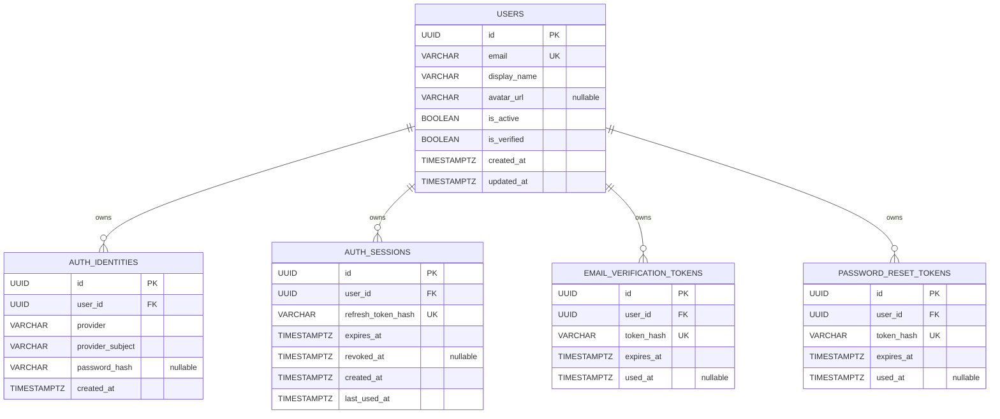

# PostgreSQL Authentication ERD

This ERD describes only the relational Authentication tables currently present in
SQLAlchemy metadata and the Alembic migration. Finance/task JSON and DynamoDB
collections are described separately in [`../database-schema.md`](../database-schema.md).

Each child `user_id` is required and references `users.id` with
`ON DELETE CASCADE`. Detailed column definitions are in
[`schema.md`](schema.md); cardinality and cascade behavior are in
[`relationships.md`](relationships.md).
