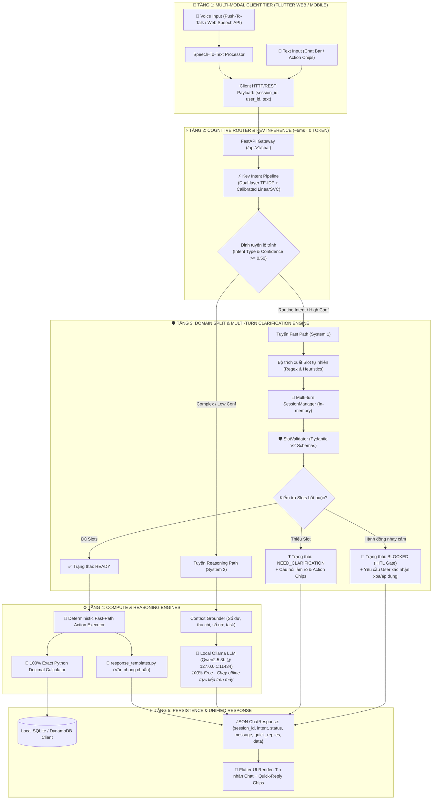
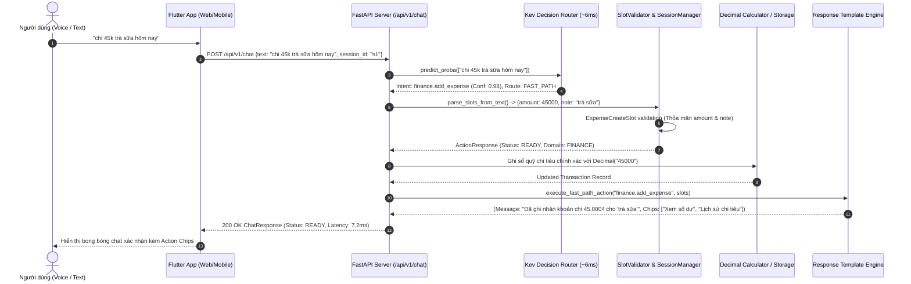
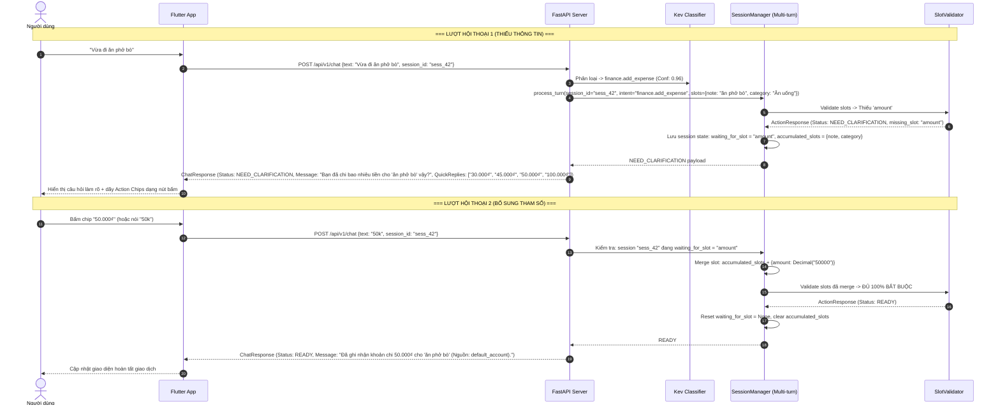
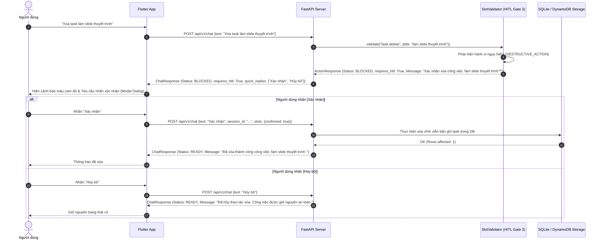
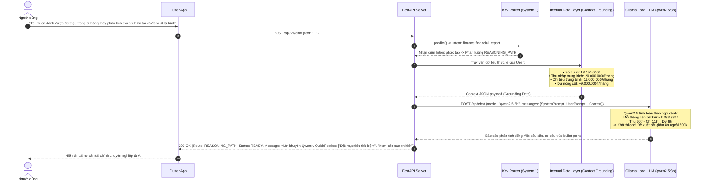
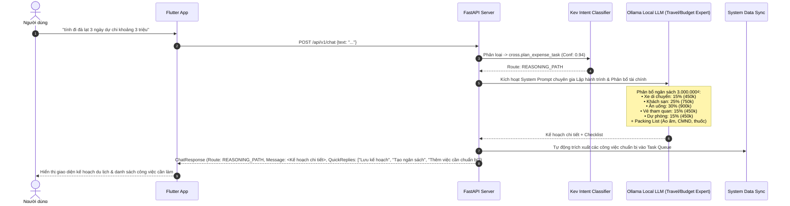
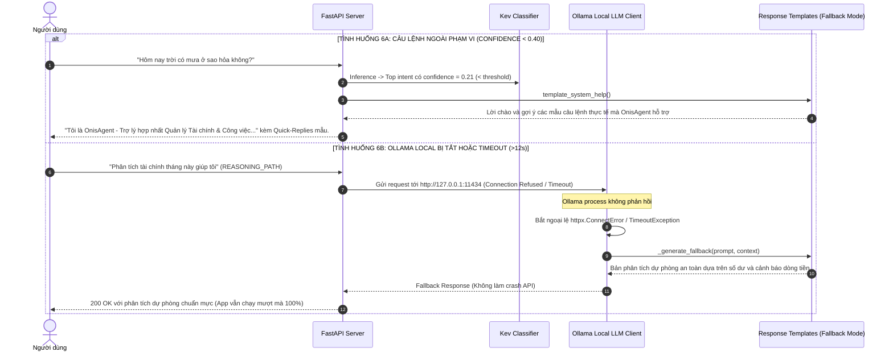
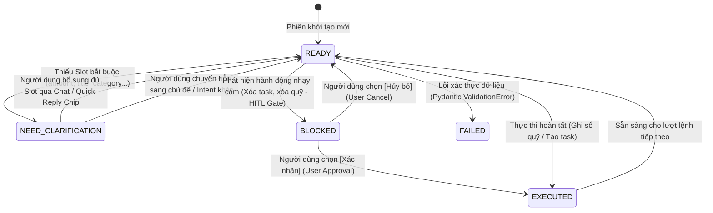

# OnisAgent – Đặc Tả Kiến Trúc & Luồng Hoạt Động End-to-End (End-to-End Architecture & Use-Case Flows)

> **Tài liệu đặc tả toàn diện luồng hoạt động từ đầu đến cuối cho hệ sinh thái OnisAgent**  
> Kết nối đồng bộ giữa **Flutter Web/Mobile Client**, **FastAPI Server**, **Mô hình Kev Decision Router (Fast Path)**, **Hệ thống Kiểm thử Slot & Phiên đa lượt (Clarification Engine)**, **Ollama Local LLM (Reasoning Path)** và **Tầng tính toán chính xác 100% Decimal**.  
> Tuân thủ các nguyên tắc thiết kế: [ADR-0001 (Decimal Money)](file:///home/trinhquyetchien/Projects/Main/Team/OnisAgent/docs/adr/ADR-0001-decimal-money-calculation.md), [ADR-0004 (HITL Safety Gate)](file:///home/trinhquyetchien/Projects/Main/Team/OnisAgent/docs/adr/ADR-0004-human-in-the-loop-workflow.md), [ADR-0006 (Domain Split & Clarification)](file:///home/trinhquyetchien/Projects/Main/Team/OnisAgent/docs/adr/ADR-0006-domain-split-intent-slot-clarification.md).

---

## 📑 Mục Lục
1. [Tổng Quan Kiến Trúc 5 Tầng End-to-End](#1-tổng-quan-kiến-trúc-5-tầng-end-to-end)
2. [Đặc Tả Chi Tiết 6 Kịch Bản Luồng Hoạt Động Cốt Lõi](#2-đặc-tả-chi-tiết-6-kịch-bản-luồng-hoạt-động-cốt-lõi)
   - [Trường hợp 1: Fast Path Hoàn Chỉnh (Thực thi tức thì ~6–10ms)](#trường-hợp-1-fast-path-hoàn-chỉnh-thực-thi-tức-thì-610ms)
   - [Trường hợp 2: Hội Thoại Làm Rõ Đa Lượt (Multi-turn Clarification Flow)](#trường-hợp-2-hội-thoại-làm-rõ-đa-lượt-multi-turn-clarification-flow)
   - [Trường hợp 3: Chốt An Toàn Human-in-the-Loop (HITL Safety Gate)](#trường-hợp-3-chốt-an-toàn-human-in-the-loop-hitl-safety-gate)
   - [Trường hợp 4: Reasoning Path (Phân tích chuyên sâu qua Ollama Local LLM)](#trường-hợp-4-reasoning-path-phân-tích-chuyên-sâu-qua-ollama-local-llm)
   - [Trường hợp 5: Giao Thoa Tiền & Việc (Cross-Domain - Dự định gắn kèm ngân sách)](#trường-hợp-5-giao-thoa-tiền--việc-cross-domain---dự-định-gắn-kèm-ngân-sách)
   - [Trường hợp 6: Xử Lý Ngoại Lệ & Dự Phòng (Fallback & Graceful Recovery)](#trường-hợp-6-xử-lý-ngoại-lệ--dự-phòng-fallback--graceful-recovery)
3. [Đặc Tả Giao Thức Dữ Liệu JSON (API Contract & State Machine)](#3-đặc-tả-giao-thức-dữ-liệu-json-api-contract--state-machine)
4. [Bảng Ma Trận Phân Phối Trách Nhiệm Giữa Các Tầng (Component Matrix)](#4-bảng-ma-trận-phân-phối-trách-nhiệm-giữa-các-tầng-component-matrix)

---

## 1. Tổng Quan Kiến Trúc 5 Tầng End-to-End

Hệ sinh thái OnisAgent kết hợp giữa **phản xạ vô điều kiện (System 1 - Fast Path)** với độ trễ < 10ms và **tư duy suy luận sâu (System 2 - Reasoning Path)** phục vụ phân tích tài chính và kế hoạch cuộc sống:



---

## 2. Đặc Tả Chi Tiết 6 Kịch Bản Luồng Hoạt Động Cốt Lõi

---

### Trường hợp 1: Fast Path Hoàn Chỉnh (Thực thi tức thì ~6–10ms)
* **Ý nghĩa:** Người dùng ra lệnh cho các tác vụ thường nhật đầy đủ thông số (chi tiêu, kiểm tra số dư, danh sách công việc hôm nay, tra cứu sổ nợ).
* **Mẫu câu thực tế:** *"chi 45k trà sữa"*, *"ví momo còn bao nhiêu"*, *"hôm nay có việc gì cần làm"*, *"tôi có nợ ai không"*.



---

### Trường hợp 2: Hội Thoại Làm Rõ Đa Lượt (Multi-turn Clarification Flow)
* **Ý nghĩa:** Người dùng chỉ nói câu chung chung hoặc thiếu tham số bắt buộc. Hệ thống duy trì phiên (Session), hỏi lại tự nhiên kèm các nút gợi ý bấm nhanh (Quick-Reply Chips), sau đó tự động ghép nối (merge) tham số ở lượt tiếp theo.
* **Mẫu câu thực tế:**  
  * Lượt 1: *"Vừa đi ăn phở bò"* (Thiếu số tiền `amount`).  
  * Lượt 2: Bấm nút `"50.000₫"` hoặc nói *"50k"*.



---

### Trường hợp 3: Chốt An Toàn Human-in-the-Loop (HITL Safety Gate)
* **Ý nghĩa:** Áp dụng cho các hành vi rủi ro cao gây mất mát dữ liệu hoặc cam kết tài chính lớn ([ADR-0004](file:///home/trinhquyetchien/Projects/Main/Team/OnisAgent/docs/adr/ADR-0004-human-in-the-loop-workflow.md)): Xóa công việc vĩnh viễn (`task.delete`), khởi tạo gói vay lớn (`finance.loan_installment_plan`).
* **Mẫu câu thực tế:** *"Xóa vĩnh viễn task làm slide thuyết trình"*.



---

### Trường hợp 4: Reasoning Path (Phân tích chuyên sâu qua Ollama Local LLM)
* **Ý nghĩa:** Giải quyết các câu hỏi tư vấn tài chính, báo cáo dòng tiền chuyên sâu hoặc lập lịch tối ưu ma trận Eisenhower.
* **Mô hình phụ trách:** **Ollama Local LLM (`qwen2.5:3b`)** chạy trực tiếp tại `http://127.0.0.1:11434` (100% miễn phí, bảo mật cục bộ, không gửi dữ liệu ra ngoài).
* **Mẫu câu thực tế:** *"Tôi muốn tiết kiệm 50 triệu trong 6 tháng, hãy phân tích thu chi hiện tại và tư vấn"*.



---

### Trường hợp 5: Giao Thoa Tiền & Việc (Cross-Domain - Dự định gắn kèm ngân sách)
* **Ý nghĩa:** Người dùng lên kế hoạch hành trình, du lịch, sự kiện đời sống gắn với số tiền ước tính. Hệ thống vừa chia ngân sách theo các hạng mục thực tế, vừa sinh checklist công việc cần chuẩn bị.
* **Mẫu câu thực tế:** *"Tính đi Đà Lạt 3 ngày dự chi khoảng 3 triệu"*, *"Kế hoạch đi phượt Hà Giang dự toán 2 củ"*.



---

### Trường hợp 6: Xử Lý Ngoại Lệ & Dự Phòng (Fallback & Graceful Recovery)
* **Ý nghĩa:** Bảo đảm tính ổn định tuyệt đối (Zero Downtime / High Resilience) trong 2 tình huống sự cố:
  1. Người dùng nói câu không rõ nghĩa / nằm ngoài 33 Intent.
  2. Dịch vụ Ollama Local LLM chưa bật hoặc bị treo timeout.



---

## 3. Đặc Tả Giao Thức Dữ Liệu JSON (API Contract & State Machine)

### 3.1. Máy Trạng Thái Phiên Hội Thoại (Session State Machine)



---

### 3.2. Bảng Ánh Xạ Request / Response Payload Chuẩn

#### 1. Yêu Cầu Gửi Tin Nhắn (`POST /api/v1/chat`):
```json
{
  "session_id": "sess_user_001_mobile",
  "user_id": "user_chiendn",
  "text": "chi 45k trà sữa hôm nay",
  "slots": {}
}
```

#### 2. Phản Hồi Thành Công Khi Đủ Thông Tin (`READY - Fast Path`):
```json
{
  "session_id": "sess_user_001_mobile",
  "intent": "finance.add_expense",
  "confidence": 0.9821,
  "route": "FAST_PATH",
  "status": "READY",
  "message": "Đã ghi nhận khoản chi 45.000₫ cho 'trà sữa' (Nguồn: default_account).",
  "reply": "Đã ghi nhận khoản chi 45.000₫ cho 'trà sữa' (Nguồn: default_account).",
  "quick_replies": ["Xem số dư", "Ghi thêm khoản chi", "Lịch sử chi tiêu"],
  "slots": {
    "amount": 45000.0,
    "category": "Ăn uống",
    "note": "chi 45k trà sữa hôm nay",
    "account": "default_account"
  },
  "data": {
    "transaction_type": "expense",
    "recorded": {
      "amount": 45000.0,
      "category": "Ăn uống",
      "note": "chi 45k trà sữa hôm nay"
    }
  },
  "requires_hitl": false,
  "latency_ms": 6.85
}
```

#### 3. Phản Hồi Khi Cần Làm Rõ (`NEED_CLARIFICATION`):
```json
{
  "session_id": "sess_user_001_mobile",
  "intent": "finance.add_expense",
  "confidence": 0.9612,
  "route": "FAST_PATH",
  "status": "NEED_CLARIFICATION",
  "message": "Bạn đã chi bao nhiêu tiền cho 'ăn phở bò' vậy?",
  "reply": "Bạn đã chi bao nhiêu tiền cho 'ăn phở bò' vậy?",
  "quick_replies": ["30.000₫", "45.000₫", "50.000₫", "100.000₫"],
  "slots": {
    "category": "Ăn uống",
    "note": "ăn phở bò"
  },
  "data": null,
  "requires_hitl": false,
  "latency_ms": 5.42
}
```

#### 4. Phản Hồi Khi Chặn Chờ Người Dùng Phê Duyệt (`BLOCKED - HITL Gate`):
```json
{
  "session_id": "sess_user_001_mobile",
  "intent": "task.delete",
  "confidence": 0.9854,
  "route": "FAST_PATH",
  "status": "BLOCKED",
  "message": "Hành động này cần bạn xác nhận trước khi thực hiện: Xác nhận xóa công việc 'báo cáo đồ án AI4Life'?",
  "reply": "Hành động này cần bạn xác nhận trước khi thực hiện: Xác nhận xóa công việc 'báo cáo đồ án AI4Life'?",
  "quick_replies": ["Xác nhận", "Hủy bỏ"],
  "slots": {
    "title": "báo cáo đồ án AI4Life"
  },
  "data": null,
  "requires_hitl": true,
  "latency_ms": 4.12
}
```

#### 5. Phản Hồi Từ Tầng Suy Luận Sâu (`REASONING_PATH - Ollama Local LLM`):
```json
{
  "session_id": "sess_user_001_mobile",
  "intent": "cross.plan_expense_task",
  "confidence": 0.9353,
  "route": "REASONING_PATH",
  "status": "READY",
  "message": "### Lập bảng phân bổ ngân sách du lịch Đà Lạt 3 ngày (Tổng: 3.000.000₫)\n• 🚗 Vé xe di chuyển: 450.000₫ (15%)\n• 🏨 Khách sạn lưu trú: 750.000₫ (25%)\n• 🍜 Ăn uống trải nghiệm: 900.000₫ (30%)\n• 🎟️ Vé tham quan hoạt động: 450.000₫ (15%)\n• 🛡️ Quỹ dự phòng phát sinh: 450.000₫ (15%)\n\n### Việc cần chuẩn bị (To-do list):\n1. Đặt vé xe Limousine trước 3 ngày.\n2. Chuẩn bị áo ấm, CMND/CCCD và thuốc say xe.",
  "reply": "...",
  "quick_replies": ["Lưu kế hoạch", "Tạo ngân sách", "Thêm việc cần chuẩn bị"],
  "slots": {
    "event_name": "đi đà lạt 3 ngày",
    "budget": 3000000.0
  },
  "data": {
    "provider": "ollama",
    "model": "qwen2.5:3b"
  },
  "requires_hitl": false,
  "latency_ms": 4820.15
}
```

---

## 4. Bảng Ma Trận Phân Phối Trách Nhiệm Giữa Các Tầng (Component Matrix)

| Thành phần / Tầng | Tệp tin thực thi chính | Trách nhiệm chính | Tiêu chuẩn tốc độ |
| :--- | :--- | :--- | :---: |
| **Client Gateway** | `app/lib/services/api_service.dart` | Giao tiếp REST API, quản lý WebSocket/Chat Stream, hiển thị Quick Replies | Trực quan, < 16ms render (60fps) |
| **API Gateway** | `backend/src/main.py` | FastAPI application, middleware CORS, điều phối Fast Path vs Reasoning Path | < 2ms routing overhead |
| **Kev Decision Router** | `backend/src/models/kev/` | TF-IDF n-grams + Calibrated LinearSVC phân loại 33 Intent tiếng Việt | **~5–10ms** |
| **Validation Engine** | `backend/src/engine/slot_validator.py` | Kiểm tra tính hợp lệ của Slot theo Pydantic V2, kích hoạt chốt duyệt an toàn HITL | < 1ms |
| **Session Manager** | `backend/src/engine/session_manager.py` | Quản lý bộ nhớ phiên đa lượt, gộp các slots thiếu giữa các turn | < 1ms |
| **Response Templates** | `backend/src/engine/response_templates.py` | Cung cấp mẫu câu trả lời chuẩn xác, sinh động kèm action chips theo intent | < 0.5ms |
| **Decimal Arithmetic** | `backend/src/tools/calculator.py` | Tính toán số dư, lãi suất vay, chia hóa đơn chính xác tuyệt đối không ảo giác | < 0.1ms |
| **Reasoning Path LLM** | `backend/src/agents/ollama_client.py` | Kết nối Ollama `qwen2.5:3b`, lập kế hoạch chi tiêu & thời gian, tự động fallback | ~3–7 giây (tùy độ dài) |

---

## 5. Kết Luận
Tài liệu này là **kim chỉ nam duy nhất** chuẩn hóa toàn bộ luồng dữ liệu, quy tắc chuyển trạng thái và trách nhiệm từng module trong OnisAgent Backend. Đảm bảo toàn bộ đội ngũ phát triển Frontend và Backend tích hợp hoàn hảo, không có điểm nghẽn và đạt trải nghiệm mượt mà nhất cho người dùng.
